# 上班工具箱 · Windows 悬浮窗

一个贴在屏幕边缘的桌面小窗口：平时只显示「还剩几小时几分」，点开是完整卡片（倒计时、进度、上班/预计下班时间）。
默认数据来自你飞书里和考勤机器人的私聊：你在那边发「1」上班、「2」下班，这边自动读到并算下班时间；不接飞书也能用，按班次时间推算。

> 当前版本 **v4.0.0**；项目 / 产品名 **上班工具箱**（2026-11-13 起，原名「下班倒计时」）。
> 程序文件名仍是 `WorkCountdown.exe`、配置目录仍是 `%APPDATA%\WorkCountdown`、安装目录 `%LOCALAPPDATA%\Programs\WorkCountdown`——这些是历史兼容路径，别改，否则老配置和老快捷方式会失效。

| 收起（贴边） | 展开 |
|---|---|
| 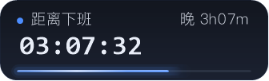 |  |

## 一图说明书

所有界面、可展示信息、日程 / 提醒规则、七个设置页和 v3.7.0 的六套界面风格，集中在一张图里：


源文件：`design/manual-poster.html`（1600 CSS 宽）；改完跑 `.\design\render-poster.ps1` 重新出图（Chrome 无头 1.5x → 2400 px 宽，自动裁掉底部空白）。第 06 节是 v3.7.0 新增的六套整体皮肤（卡片 / 设置页 / 小纸条 / 胶囊）。

## 现在就能用

- 桌面已经放好快捷方式 **上班工具箱**，双击即可启动；启动后贴在主屏右侧边缘。
- **第一次启动**会弹一个引导窗口，问上下班时间、午休、要不要读飞书打卡；填完点「开始用」。
- **整套换皮肤（v3.7.0）**：设置 →「外观」→「界面风格」六选一（默认 / 无垠 / 云母 / 宣纸 / 仪表 / 霓虹），点一下预览、点「保存」后悬浮窗立刻换，详见下面「界面风格」。
- 启动后**不会**重复开第二个：再双击只会静默退出（单实例）。
- 退出：托盘图标右键 → 退出。

## 界面怎么用

收起态是一条**横向**的小横条，一眼能读完：

```
● 距离下班                    下班 20:04
05:30:56
▔▔▔▔▔▔▔▔▔▔▔▔▔▔▔▔▔
```

左边状态点 + 一行说明，中间大号等宽倒计时，右上角是预计下班时间（午休时段换成「休 1h05m」），底部一条细进度。

| 操作 | 效果 |
|---|---|
| 单击收起态的横条 | 展开成卡片 |
| 卡片右上角 `✈` | 打开**小纸条**（对话，见下面「小纸条」） |
| 卡片右上角 `⚙` | 打开设置 |
| 卡片右上角 `↻` | 立刻重新读一次飞书 |
| 卡片右上角 `›` | 收回成横条 |
| 按住拖动 | 移动；松手靠近左右边缘会自动吸附贴边，位置会记住 |
| 展开后 20 秒没动静 | 自动收回（设置里可改，0 = 不自动） |
| 右键卡片 | 弹出**胶囊菜单**：新增日程 / 修改主题 / 触发上下班 / 窗口置顶 / 预览通知 / 检查更新（详见下面「右键胶囊」） |
| 托盘图标右键 | 设置、立即同步、刷新日程、下一个日程、预览提醒动画、在飞书发「1」/「2」打卡、展开/收起、今天设为休息日/上班日、窗口置顶、开机自启、导出/导入配置、退出 |

### 右键胶囊

在卡片上点右键，贴着卡片外侧竖排弹出六颗胶囊（每颗是「图标 + 文字」）。点开的那颗会**原地长成一张 246 宽的大卡片**，下面的胶囊被顶下去，内容稍后淡入；颜色跟当前主题走（浅色主题下也是浅色胶囊）。

v3.2 起六颗胶囊和长开的卡片都改成**一条 1 DIP 的主题色细边**（悬停 / 选中只把这条边变亮），下面**不再画投影**，贴在桌面或卡片旁边更干净。收起时整块菜单**先淡出、再往卡片方向缩回**（180ms），不会「啪」一下消失；点胶囊里的动作也是等它淡完再执行，设置窗 / 调色盘不会被菜单压住。

| 胶囊 | 行为 |
|---|---|
| 新增日程 | 卡片里默认「临时日程」+ 30 分钟：**标题和地点可以直接点进去改**，点 **+15 / +30 / +60 分钟** 或「保存日程」就建；「详细编辑…」进设置 → 提醒 |
| 修改主题 | 卡片里是**主题色卡**：4 列 × 3 行一屏 12 张，鼠标在上面滚轮往下翻，点一张立刻换；底部「＋ 新建主题」直接开调色盘，建完立刻切过去 |
| 触发上下班 | 两行「上班打卡 / 下班打卡」，对应飞书里发「1」/「2」（会先确认） |
| 窗口置顶 | 没有内容，点一下直接切换；胶囊文字变成「已置顶」，再点取消 |
| 预览通知（v3.6） | 卡片里是 6 类通知：上班提醒 / 午休提醒 / 飞书会议 / Outlook / 普通日程 / 下班提醒。点一类就在卡片上**真播一遍**该类提醒的动画（用它自己的配色和扩散样式），只放一遍就自动退场，不改日程、不弹托盘气泡 |
| 检查更新（v3.6） | 展开就自动查 GitHub 最新 Release：显示当前 / 最新版本、更新说明，可以**全量更新**（下载新版 exe → 校验 → 替换 → 自动重启，配置和对话都保留）；已是最新就显示「已经是最新版本」，查不到就给「打开发布页」 |

点空白处、再点一次右键或按 Esc 收起；点另一颗胶囊时，旧卡片先缩回胶囊，新的再长开。

**主题色卡**是一张小卡片：主题底色 + 左边一块强调色方块 + 右边竖排名字（`经典 · 午夜蓝` 只显示后半段「午夜蓝」，自建主题用原名，最多 3 个字）。全部 39 套内置主题 + 自建主题都在同一个列表里，滚轮一格滚一行，右边有一根 2px 的滚动条；打开面板时会先滚到当前用的那套。

窗口默认**始终置顶**（设置里或胶囊菜单的「窗口置顶」可以关）。置顶不是只设一次：程序每 2 秒检查一次窗口的 `WS_EX_TOPMOST`，被系统或别的程序摘掉就补回来；换显示器 / 改缩放（`WM_DISPLAYCHANGE`）、从托盘恢复、设置窗口关掉之后也会重新压到最上层。托盘菜单里那个勾选状态每次打开都按当前配置刷新，不会因为先在设置页改过就点反。

## 固定日程（午休 / 晚休 / 下班 / 自己加）

卡片里除了主倒计时，还有一行「接下来是什么」，按当前时刻自动切换，一天走完这一列：

| 时刻 | 显示 |
|---|---|
| 11:50 之前 | `● 距午休 1h30m`（每分钟跟着走） |
| 11:50–13:30 | `● 午休中 还剩 1h05m`（数值变成强调色） |
| 13:30–18:00 | `● 距晚休 4h30m` |
| 18:00–18:45 | `● 晚休中 还剩 35m` |
| 18:45 之后 | `● 马上下班` |

时间来自设置 →「固定日程」里的那几条，**和「计入工时扣除」开关无关**：扣除只决定工时怎么算，倒计时只按时间点走。收起成横条时，右上角显示 `休 1h30m` / `晚 45m`。

没开晚休时，午休结束这一行改成 `距下班 2h10m`，到点同样变成 `马上下班`——不会凭空出现一个你没设过的晚休时间。

设置里「显示午休倒计时」可以关掉，卡片会退回原高度、不留空白；午休时间填错（比如 `25:00`）时这行自动不显示。

### 固定日程表

设置 →「固定日程」是一张表，**午休、晚休、下班本身就是表里的三条**，点一条改一条；想加「站会」「拉伸」「吃药」这类固定动作，点「新建一条」。每条能设：

| 项 | 说明 |
|---|---|
| 名称 | 提醒里显示的名字 |
| 开始 – 结束 | `HH:mm`；结束留空 = 只响一次（打卡类的用这个）；有结束时间就一直盖到结束 |
| 重复 | **每天** / **单数周** / **双数周**（按 ISO 周，周一是第一天） |
| 重复至 | 到某年某月某日为止（含当天），勾「永久」就不设截止 |
| 配色 | 从现有主题色里挑一套，直接用在提醒色带上；`跟随当前主题` 会跟着外观页的主题走 |
| 启用 / 到点提醒 | 停用后既不显示也不响；到点提醒关掉只留卡片上的倒计时 |
| 结束时也提醒 | 结束那一刻再响一次（午休结束、晚休结束就是它） |
| 计入工时扣除 | 只有午休用：勾上后这段时间从应勤时长里扣掉，下班时间往后顺延 |

「下班」这条不用填开始时间——时间来自班次（弹性工时 = 打卡 + 应勤），它只负责「该下班啦」这个提醒什么时候弹；重复规则决定哪天弹。

三条内置的只能改、不能删（防止误删把卡片搞空），自己加的可以删。所有固定日程**只在工作日触发**，节假日/调休按「考勤」页设置走。

### 午休 / 晚休到点提醒

| 设置项 | 默认 | 作用 |
|---|---|---|
| 午休 `11:50` 至 `13:30` | 已填 | 卡片上的午休倒计时 + 到点提醒 |
| 晚休 `18:00` 至 `18:45` | 已启用 | 卡片上的晚休倒计时 + 到点提醒 |
| 到点提醒 / 结束时也提醒 | 已勾选 | 到点自动弹同款提醒动画 |

四个时间点各响一次（每天一次，只在工作日响）：`午休时间到`、`午休结束`、`晚休时间到`、`晚休结束`。动画里显示时段区间和「还剩 40 分钟」，配色跟着这条日程选的色走，一眼能区分「这是休息，不是会议」。

**休息期间一直盖着**：`午休时间到` 响起之后不会自己退，会一直盖到 13:30（你设的休息结束），上面那行「还剩 40 分钟」每秒跟着走；到点播退场动画、恢复正常卡片。`午休结束` 那条因为本身是瞬间，只按最短停留放几秒。晚休同理，从 17:50 盖到 19:00。嫌挡着就点右上角 `×`。

**中途才打开也不会漏**：如果 18:10 才启动（或重启）程序，正处在晚休里，会直接补一张「晚休中 17:50–19:00 · 还剩 50 分钟」的常驻卡，不用等到下一次 17:50。

取消「到点提醒」就只保留卡片上的倒计时，不弹动画。

### 四类日程

日程按来源分成四类，**每一类单独选通知样式**（设置 → 日程）：

| 类型 | 从哪来 | 能不能改 |
|---|---|---|
| 固定日程 | 午休 / 晚休 / 下班 + 自己加的重复日程（每天 / 单数周 / 双数周） | 设置 → 固定日程，每条还能单独选配色 |
| 飞书会议 | 本机已登录的飞书账号里的日程（`lark-cli calendar +agenda`） | 设置 → 提醒 → 读取飞书日程 |
| 普通日程 | 手动添加：胶囊菜单「新增日程」快速加，或设置 → 提醒 → 日程与提醒里增删改 | 随便改 |
| Outlook 日程 | Outlook / Exchange 日历的 `.ics` 订阅（见下一节） | 只读，跟着订阅走 |

设置 → 日程 →「四类日程的通知样式」，一行一类，三个下拉：

| 下拉 | 选项 |
|---|---|
| 提醒范围 | 卡内 / 全屏 |
| 扩散样式 | 圆形柔光 / 进度条拉伸 / 警戒带 |
| 配色 | 跟随当前主题 + 39 套主题 |

- 固定日程的每一条还能在「固定日程」页单独选配色，**那里选的优先**；
- 老配置升级上来时，四类样式按原来的「提醒扩散 / 扩散样式」补齐，行为不变；
- 下次改的时候只动对应的那一行，其它三类不受影响。

### Outlook / Exchange 日程（可订阅多份）

设置 → 日程 →「＋ 添加」可以加**多份**日历，工作日历、个人日历、项目日历各订阅一份，互不影响：

1. 点「＋ 添加」，起个名字（比如「工作日历」）；
2. 来源选「订阅地址」，把链接粘进去（也可以选「本地 .ics」直接读导出的文件）；
3. 点「立即同步」看结果；每份日历可以单独设提前量，0 = 用上面的「默认提前」。

列表里每一行前面的勾就是启用 / 停用；双击一行编辑，删除只删本地订阅，不会动 Outlook 里的日历。某一份拉失败只会把它自己标红，其它日历照常提醒，失败的那份继续用上次成功的缓存。

拿链接：**Outlook 网页版 → 设置 → 日历 → 共享日历 → 发布日历**，选「仅忙闲」或「完整详细信息」，把生成的 `.ics` 链接复制过来（Gmail / iCloud 发布出来的 `.ics` 也能用）。

- 只同步**之后 14 天**的日程；每份日历的结果各自存在 `settings.json` 的 `outlook.calendars[].cached` 里，重启后先拿缓存顶着；
- 提醒提前量可以按日历单独覆盖（默认 10 分钟），和飞书会议、普通日程各自的提前量分开；
- 认 `RRULE`（每天 / 每周 BYDAY / 每月 / 每年，含 INTERVAL、COUNT、UNTIL）和 `EXDATE`；**全天事件（节假日）不提醒**，`CANCELLED` 的、被改单次（`RECURRENCE-ID`）的直接跳过；
- 网络失败只写日志 + 状态行，不影响其它日历和另外三类日程。

**同步晚于开始也会补提醒**：如果 Outlook 在会议开始后才把日程同步下来（发布日历有延迟、程序刚启动、轮询还没到），严格「开始前 N 分钟」的窗口已经错过。只要这条日程是刚看到的、还没结束、且开始不超过 60 分钟，就会补放一次提醒，文案显示「正在进行」；整场会不再一声不响。

**第二种：登录 Outlook（Graph）**。不想手动发布 `.ics` 就走这条：

1. Azure 门户 → 应用注册 → 新注册 → 记下**应用程序(客户端) ID**；
2. 身份验证 → 打开**允许公共客户端流**；
3. API 权限 → Microsoft Graph → 委托的权限 → 加 **Calendars.Read**；
4. 设置 → 日程 → 点「Outlook 登录」→ 粘 client ID → 点「登录 Outlook」；
5. 浏览器跳到微软登录页，把剪贴板里的 8 位代码填进去授权，回来就自动登录、加一份「Outlook 登录日历」并同步。

- 刷新令牌用 Windows 的 DPAPI 加密后存在 `settings.json`（只有当前 Windows 用户能解），access token 只在内存里；
- 登录失效时设置页状态行会提示「登录已失效」，点「Outlook 账号」→「退出登录」再登一次；
- 一样只同步未来 14 天、15 分钟一次；Graph 日历只能加一份，其它日历请用 .ics 订阅。

### 工资面板（v3.1 起，v3.2 取消双击固定）

设置 → 工资：填**月工资**和**发薪日**（1–31 号；当月没有 31 号时按最后一天）。保存后卡片右上角出现第 4 个按钮 `¥`：

| 操作 | 效果 |
|---|---|
| 单击 `¥` | 大卡片向下拉长，展开工资面板；再点收起 |
| 没填月工资时点 `¥` | 直接打开设置 → 工资 |

> v3.2 起**取消了双击固定**：`¥` 只有单击展开 / 收起一个动作，面板不再常驻、也不再写 `ui.salaryPinned`；老配置里残留的这个字段会被直接忽略。

面板主线是**今日当前收入**，保留 3 位小数；工资面板按 18fps 重绘，后三位小数每秒高速跳动。**今日收入的进度条已取消**：整数位用主题色渐变 + 常驻柔光 + 6.5 秒一轮的流动高光，小数位保持白色；**浅色主题会自动把整数位渐变压深、流光降亮**，不会出现白底浅蓝字看不清。下面是本月收入和发薪日倒计时；原来的「已工作 / 计薪」一行已去掉。展开 / 收起时卡片高度按缓动变化，header / 大数字 / 本月收入三行按 180 / 220 / 220ms 依次浮现，和卡片本身的错峰节奏一致。

计算口径（面板和设置页写的一致）：

- **本月应出勤天数**按「考勤」页的工作日 + 节假日 / 调休自动算，不另填；
- **日薪** = 月工资 ÷ 本月应出勤天数；
- **时薪** = 日薪 ÷ 当日应勤时长：固定班次扣掉午休 / 晚休，弹性班次用填的「每日应勤」；
- **今日收入** = 时薪 × 今天已工作秒数（扣午休 / 晚休），最多到日薪；
- **本月收入** = 日薪 × 本月已完成的工作日 + 今日收入；
- 没有历史打卡记录，所以只按「日期 + 今天这一次打卡」推算，默认之前的工作日都正常出勤；
- 休息日今日收入为 0，本月收入只算已经过去的工作日。

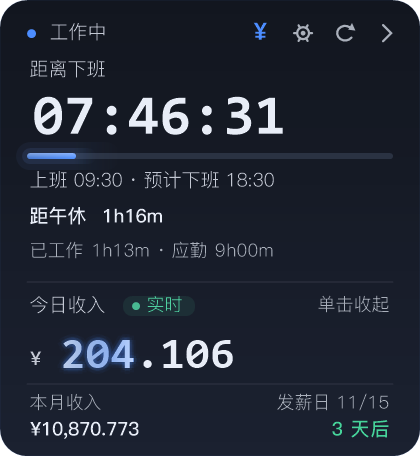

浅色主题（象牙白）：整数位自动压深，小数位用深色文字，保证白底可读：

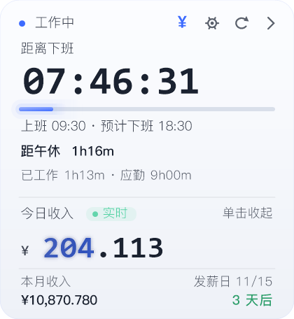

后三位小数按 18fps 跳动（55ms 一帧，每帧约 +0.003）：

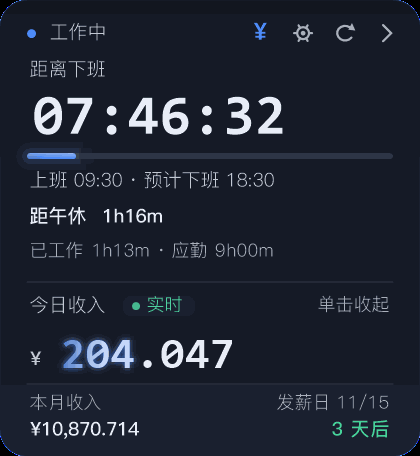

展开时窗口先长高，header / 大数字 / 本月收入三行依次浮现：

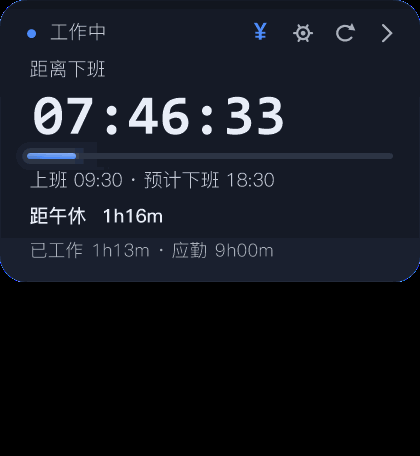

面板右上角只留一个「单击收起」的弱提示；没有固定状态，所以重启后卡片从收起态开始。

### 小纸条（对话，v3.3 起）

卡片右上角 `¥` 左边多了一颗**小飞机**（`✈`）。点开是「小纸条」面板；没有账号，每台电脑第一次启动生成一个 **5 位数 ID**（设置 → 纸条 可复制 / 重新生成）：

| 操作 | 效果 |
|---|---|
| 点对话胶囊 | 看和对方的**最后一条**消息 + 底部输入框；鼠标 hover 也会直接切过去 |
| 点输入框 | 面板向上长高，展开**历史消息**：一屏 8 条，每个对话最多留 16 条，更早的用鼠标滚轮往上翻（右侧有细滚动条和「往上翻了 N 条」提示）；回车发送一行文字 |
| 发完一条 | **输入框留在原地、清空**，接着打下一句就行（不用再点一次）；不会整块刷新 —— 旧消息上移、新消息进入，也不显示「已发出」 |
| 双击对话名字 | 改名字（最多 8 字）：盖在名字上的小编辑窗**文字居中、字号比列表大一号**；回车或点别处保存，Esc 取消 |
| 点「＋ 新建对话」 | 输入**任意 5 位字符**建对话：5 位数字 = 和这个 ID 的人单独对话（自动查在线）；其它 5 位字符 = **对话码**，别人输入同一个码就进同一个对话 |
| 双击「昵称」胶囊（v3.6） | 卡片页「＋ 新建对话」左边那颗昵称胶囊，**双击**就地改本机昵称（≤12 字），不用进设置页；单击只提示一句，不会误弹窗。改完立刻广播给已有联系人 |
| 对话多了（v3.6 两排） | 对话列表页一屏**两排**（4×2 = 8 个），对话 ≤4 个时还是一排；在面板上**滚鼠标滚轮**看后面的对话（抽屉式 / 双栏都支持，右下角有滚动提示） |
| 右键某个对话 | 该对话上弹出红色「删除」按钮，点一下连本机这段 16 条消息一起删掉 |
| 收到纸条 | **卡片圆角边框连闪 2 次**（收到那一刻）；没读时**卡片左上角每 5 秒快闪两下**（收起态 / 展开态都有），点开读完即停 |

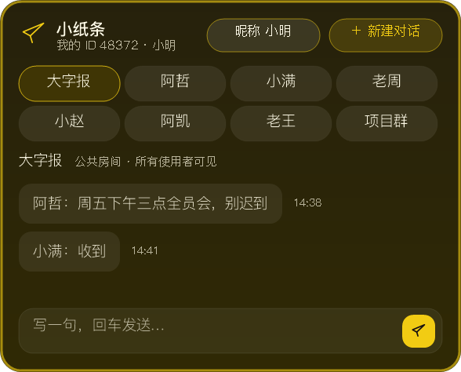

- **两种对话**：`5 位数字` = 按个人 ID 的 1:1（收件箱主题 `xzt/v1/msg/<ID>`）；`任意其它 5 位字符`（中文 / 字母 / 数字 / 混合）= 对话码，收发主题 `xzt/v1/room/<hex(UTF8(码))>`，**不同的人输入同一个对话码就进同一个对话**；消息里始终带着发送者的 5 位 ID，对话码气泡前面也会写 `ID 12345：`，看到就能直接按 ID 建一对一对话；
- **昵称**：设置 → 纸条 里填自己的昵称（≤12 字），随在线状态（retained presence）广播；别人加你的对话会自动拿到并显示，对话码群聊里别人的消息前缀直接是昵称（`昵称：内容`），没昵称才退回 `ID 12345：`；本机给对话框写的「备注」优先级最高（备注 > 对方昵称 > ID）；
- **公共中继**：默认 `broker.hivemq.com:1883`（MQTT）；设置 → 纸条 里可改地址/端口并「测试连接」；对方不在线时这条发不出去（公共 broker 不存离线消息）；
- **两套面板**：设置 → 纸条 里选 **抽屉式（A，默认）** 或 **极简双栏（C）**，数据和动画完全一致；
- **还没选对话时抽屉式会收窄**：392×124 DIP（150% 588×186），点开对话再长回 392×282；**对话超过 4 个时列表页铺两排**、面板长到 158 DIP（588×237），一屏能看 8 个；
- **卡片页改昵称（v3.6）**：头部「＋ 新建对话」左边有昵称胶囊，双击就地编辑；没填时显示虚线「＋ 昵称」；
- **对话名字**居中、字号比正文大一号；**双击名字**就地改名字（小编辑窗和名字一样大、普通输入框样式，不放大）；
- **进对话不整体淡入**（浅色主题下不会像盖一层白纱）；浅色主题也不用半透明白填充，收到的气泡是淡墨色，边界看得清；
- **面板尺寸 / 字号**：按 96 DPI 设计稿的 DIP 走 —— 抽屉式 392×282 DIP（未选对话 124、历史态 476 高）、双栏 470×298（历史态 512），聊天正文 9.4pt、标题 10.5pt，和卡片正文 9.5pt 同级；150% 缩放下就是 588×423 / 705×447 物理像素。**不要按卡片宽度等比缩**（那会只剩 6.25pt，字小到看不清）；
- **气泡 / 编辑窗**：聊天气泡文字垂直居中、时间放在气泡外侧（自己发的在左、收到的在右），抽屉式历史行高固定（一屏 8 条，最多 16 条，滚轮往上翻更早的），新消息从底部进入、老消息整体上移；弹出的输入 / 改名字小窗是**圆角**、和面板里的圆角输入框对齐；整张面板沿圆角有 **1.8 DIP 边框**（比最早的 1 DIP 粗一点）；
- 公共中继明文转发，别发密码等敏感内容；对话码没有密码，**知道码的人都能进**，别用公司名 / 工号之类猜得到的码。

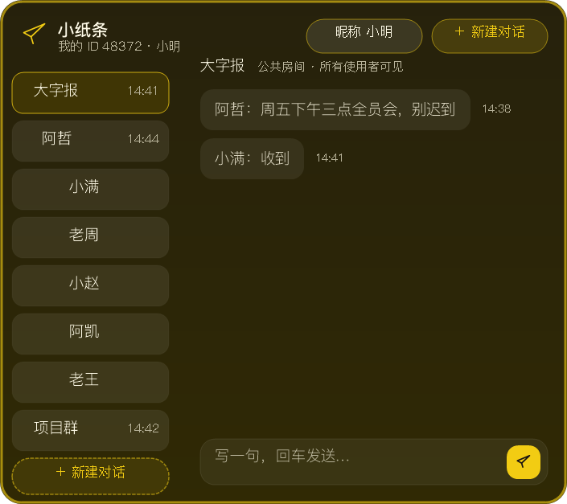

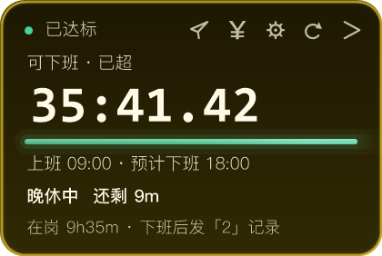

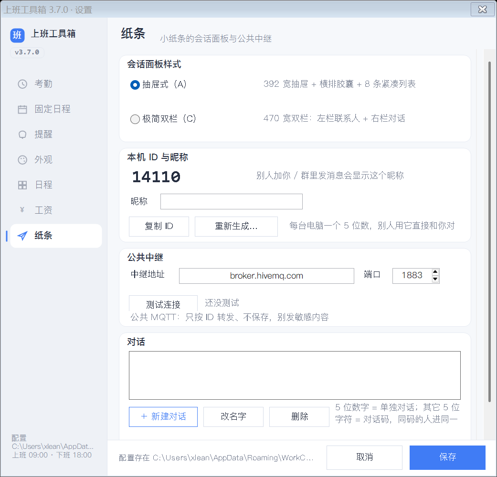

### 提醒动画：全屏 / 卡片内，三种扩散

样式按四类日程分开设（见上面「四类日程」），三类扩散样式的画法一样：

- 两种扩散样式都从**进度条已经走过的那一端**（已走段的末端）开始扩散，带柔边：圆形柔光是一团软边圆；进度条拉伸是已走段先横向拉满、再纵向撑开。
- 扩散铺满后，**下方第二块色块和上方标题同时擦出**；圆形样式是上下对擦，进度条样式共用一条左→右的擦线。退场反过来。
- **警戒带**是第三种全屏样式：不做铺满，只在屏幕正中压一条整屏宽、60 DIP 高的黄条（上下各 8 DIP 黄黑警示斜纹）。内容只有「类型 + 标题」，重复铺满整条，间距 35 DIP；文字 70 DIP/s 向左滚，斜纹 100 DIP/s 向右平移（方向相反）。整条底色从实黄呼吸到全透明（2.33 秒一轮），黑字同步反成黄字；透明相里文字带一层黑影，浅色壁纸也读得清。条外一个像素都不画，桌面原样透出来。
- **全屏**只覆盖小组件所在的那块屏，入场约 1 秒、停留最多 6 秒，然后自动收回卡片；提醒本身继续按原来的「常驻到时段结束」留在卡片上。点全屏任意处立即收回。全屏用一张开始时的桌面截图做底，所以柔边透出的是当时的桌面（静止一帧），不依赖分层窗放大。
- **颜色**：每类日程取设置 → 日程里给这一类选的配色；固定日程每条自选的配色优先。警戒带自己用固定的工业黄，不跟主题走。
- **警戒带之后的抽屉卡**：黄条起来之前，小卡片先展开成大卡（400ms）；黄条放完、卡片收回小卡（400ms）后再等 0.3 秒，从贴边的那一侧反向拉出一张抽屉卡 —— 实心工业黄 `#F5C400`、和卡片同高 68 DIP、外角 14，两行字：标题 / 时间段 · 地点 · 剩余时间。文字走同色系三阶（标题 `#33260A`、时间地点 `#5C4400`、剩余时间 `#8A3D00`，对比度 9.0 / 5.6 / 4.7），不写「会议提醒」这类类型标签。抽屉用 550ms、`cubic-bezier(.22,.9,.28,1)` 从卡片底下滑出（先快后慢），宽度不够时内容被硬裁、不会提前露；字号 17px/13px、行距 7 DIP，字族用微软雅黑（和警戒带同一套）；一直留到日程结束，点一下收回。贴左的卡片往右拉，贴右的往左拉。
- 警戒带期间**卡片不做色块覆盖**：不铺色、不擦出，只显示普通卡片，信息交给黄条和抽屉卡。
- 「减少动态效果」或高对比度下不走全屏，直接显示卡片提醒；警戒带也一样。

### 卡片背景光效

同一个「外观」页里的「背景光效」：

| 选项 | 效果 |
|---|---|
| 原样式（默认） | 和 v2.7.0 一样，只有主题渐变，不额外加光 |
| 角落柔光 A | 左上主光 + 右下反光，最接近“只稍微亮一点” |
| 进度条同色光 B | 光从进度条附近晕开，跟进度条的高亮色呼应 |
| 两种都开 A+B | A + B 一起叠 |

- 强度固定在 **1.6×**（只对加光模式生效）；光取当前主题的强调色（自建主题就是进度条色），所以换主题/换配色会跟着变。
- 只叠在卡片背景上，文字、进度条自身的高光、提醒色块都不动；光效是静态的，不额外跑动画。

### 磨砂玻璃背景（v3.6）

「外观」页「主题配色」卡片底部新增 **背景风格：纯色 / 磨砂玻璃**：

- **纯色** = 原来的主题渐变（默认，行为不变）；
- **磨砂玻璃** = **半透明主题底色 + 两团柔光雾气 + 模糊过的磨砂颗粒 + 斜向反光带 + 顶部高光/底部暗边**，桌面会真的从卡片后面透出来（分层窗逐像素 alpha）。同一套风格也用在**小纸条面板**和**右键胶囊气泡**上，三处一起变。
- 磨砂是「拟态」不是真实背景模糊：真实抓屏模糊在秒/厘秒刷新时会掉帧，而且分层窗会把自己拍进去。想要更透/更实可以换主题（深色主题的玻璃更暗、浅色更亮），或换回纯色。
- 老配置没有这个字段 → 一律按纯色处理，不会突然变玻璃。

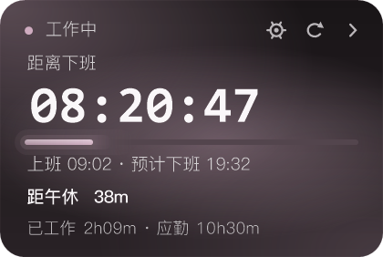

### 卡片背面的流光

卡片**外面**另开一张点击穿透的分层窗（窗口四边各留 56 DIP 给光晕），画两层，对齐 `design/card-glow-3.html` 第 3 列：

| 层 | 做法 | 参数 |
|---|---|---|
| 呼吸柔光 | 强调色铺一块比卡片外扩 12 DIP 的圆角矩形，按高斯模糊（缩到 1/2、3 次盒模糊近似），再按呼吸曲线改透明度 | 模糊 σ≈18 DIP；透明度 0.34→0.62，4.2 秒一轮 |
| 贴边窄光 | 对应 HTML 里卡片自带的 `box-shadow: 0 0 22px 45%`，同样是模糊过的卡片轮廓 | σ≈10 DIP，固定 45% |
| 边缘扫边 | 一段**约 86° 的锥形亮带**沿圆角边框跑，按角度取色（72% 起亮 → 82% 强调色 → 85% 白心 → 88% 回落 → 96% 熄灭），只露出贴边 1–2px 的一圈 | 5.5 秒一圈，白心 `Mix(accent, white, 0.62)` 收在亮带正中 |

- 关键点：**不是整圈亮边**。亮带按角度算色再旋转，小卡上是「一道光在跑」，不会糊成相框；整圈亮边（旧版那条 `DrawRim`）已经去掉。
- 光色全取当前主题的强调色，换主题/换配色立刻跟着变；浅色主题整体压到 55%，免得白底发糊。
- 柔光一秒只变二十来次，所以按呼吸档位烘一张底图，每帧只贴一次再画扫边（588×450 的窗口实测约 4 ms/帧，含重建档位）。
- 「减少动态效果」或高对比度下这一层根本不创建，卡片只剩主题渐变。
- 出图对照：`test\GlowShot.exe midnight 0,90,180,270 0.5` 把时钟钉在扫边的 0/90/180/270°、柔光钉在 0.5，输出 `test\visual\{small,big}-midnight-r*.png`；设计稿那一侧把 `design/card-glow-3.html` 的 `.s-edge .borderlight::before` 改成 `animation:none;transform:rotate(Ndeg)`、`.s-edge .halo` 改成 `animation:none;opacity:.5` 再截图，两边逐像素比过环形亮度曲线。


### 到点不走？常驻「该下班啦」

到下班时间还没在飞书里打卡，卡片会一直被这条提醒盖住：

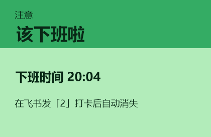

逐帧的样子（`alert-preview.gif` 是动图）：

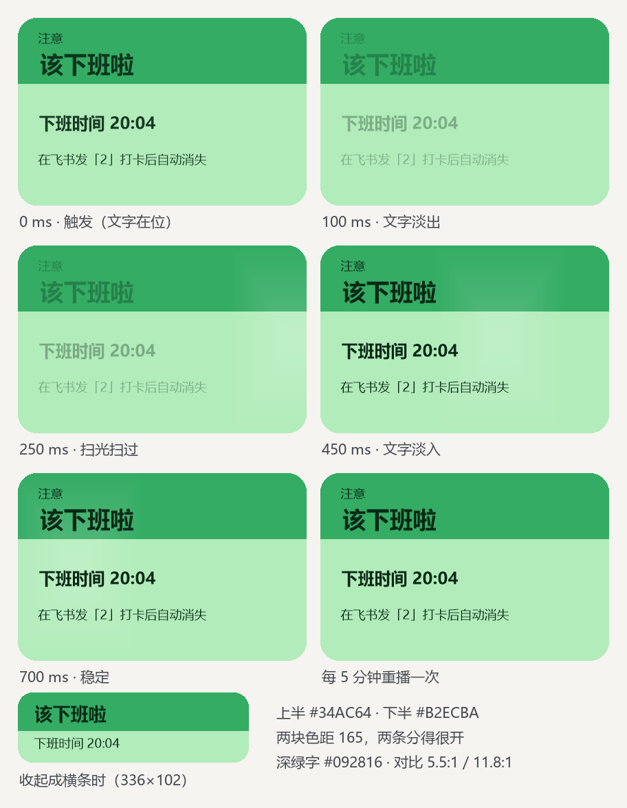

- 第一行 `注意`，第二行 `该下班啦`，下面两行是下班时间和「在飞书发「2」打卡后自动消失」。
- **配色是清爽绿**，不是警示红：默认取「经典 · 松林绿」，上半 `#56BB7C`、下半浅薄荷 `#A2E4BB`，两块色距 106，一眼看得出是两条；字用深绿，对比度 7.8:1 / 12.7:1。这套也能换（设置 → 外观 → 提醒配色 → 下班，39 套主题任选）。
- **常驻**：不会自己走掉，也不会自动收起成横条。
- 右上角 `×`（或托盘菜单 →「关闭当前提醒」）＝ 忽略今天，今天不再弹，第二天自动恢复。
- **每 5 分钟重播一次**：文字淡出再淡入，卡片本身不动——不闪屏但看得见。
- 飞书一同步到下班打卡（或你手动改系统时间过跨天），立即收掉，恢复正常卡片。
- 万一飞书读不到、或者你今天就打算不走这一趟：托盘菜单 →「忽略今天的下班提醒」，今天不再弹，第二天自动恢复。
- 中间如果插进来一个会议/日程提醒，它播完会回到这条常驻提醒。
- 静止期间不跑 30fps 的动画计时器，只在重播那 1.1 秒里刷新，平时几乎不占 CPU。

## 外观与主题

**39 套内置配色 + 自己调的无限多套**，设置 →「外观」里点一下色块就生效（悬停显示名字，选中的外圈发蓝光）。这一节是「默认」界面风格下的配色；切到其它皮肤时这 39 套会置灰，见下面「界面风格」。

每格是**卡片缩略图**：底色占绝大部分，高亮色只做底部一条「进度条」和左上角一个状态点——比例和真实卡片一致，扫一眼就知道换上之后是什么样子（实测高亮色占 10%–11%，不会再出现「整块砖头色」那种占比失衡）。


- **经典 7 套**：午夜蓝（默认）、极光青、落日橙、樱花粉、松林绿、石墨灰、象牙白——手工调过对比度。
- **中国传统色 32 套**：紫 / 绿 / 灰 / 棕 / 蓝 / 黄 / 红 / 白 八个色系，每系四色（凤信、藤萝、豆蔻、桔梗……），颜色直接从你给的色卡上取样。
- 色卡每格只给一个主色，其余颜色按主色推导：卡片底取主色的极暗版，强调色（状态点、进度条、图标）保持原色相——太暗的提亮、太亮的压深，尽量不兑成灰。
- 四个「白」系（鱼肚、珍珠、银苗、荷花）是浅色卡片，文字自动转深色，白天挨着飞书窗口不刺眼。

每套主题定义的是完整配色：卡片渐变底色、主/次/弱三级文字色、进度条轨道色、强调色，以及「已达标 / 已下班」用的成功色。

### 自己调一套主题

色卡右边「＋ 新建主题」打开调色窗；如果当前选中的是自建主题，「编辑」会亮起来，可以反复改。调色窗里有**两个色块**：

- **背景**：卡片渐变底、轨道色、文字明暗都由它推导（深色自动配浅字，浅色自动配深字）。
- **进度条**：只决定进度条、状态点、图标和背景光效的强调色。

点「背景」或「进度条」切换要调的那个，再用色相条选颜色家族、方块里选深浅；右边实时预览「这个背景 + 这个进度条」的小卡片。起个名字保存，它就变成色卡里的一格，**存在 `settings.json` 里**，换主题、重启都在；不想要了下次删掉配置里的那一条即可。

内置主题不能直接改（「编辑」置灰）；想基于某套内置主题改，选中它点「＋ 新建主题」，会把它的背景色和进度条色作为起点。


### 字体

设置 →「外观」→「字体…」：**中文字体和数字字体分开选**，下拉里是系统已装的字体（加上 `fonts\` 目录里的私有字体）。

- 中文默认跟随系统（苹方 → Noto Sans SC → 微软雅黑），选了就只影响界面文字；
- 数字默认 Consolas，影响大号倒计时、收起横条数字、工资数字和 `¥` 图标；建议选等宽字体，倒计时不会左右跳；
- 下方有一张和卡片同色的实时预览：中文样张、`05:05:17`、`¥12,345.678`；点「确定」后再点设置页「保存」生效，悬浮窗会立即重建字体。

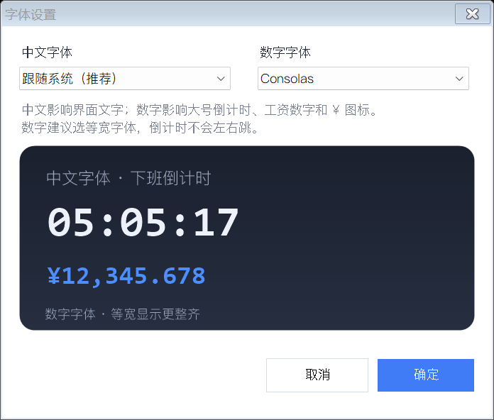

调色窗里的主题预览也改成按 DPI 缩放绘制，150% 下「背景 / 进度条」两行不再和进度条或彼此重叠。

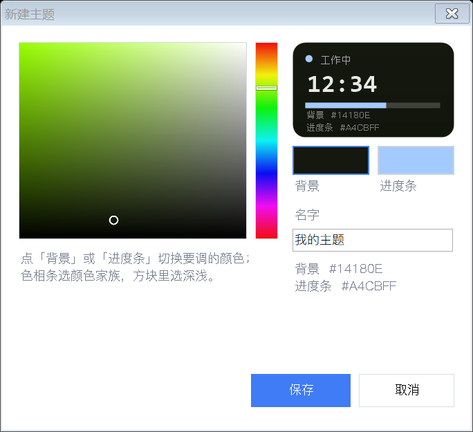

## 界面风格（v3.7.0，六套）

v3.7.0 起，「外观」页最上面多了**界面风格**：不是只换一套配色，而是**卡片 / 设置窗口 / 小纸条 / 右键胶囊 / 提醒整套一起换**。点一下风格块就在窗口里立刻预览，点「保存」后悬浮窗立即换，不用重启。

| 风格 | 定位 | 配色 / 质感 | 进度条 | 装饰 |
|---|---|---|---|---|
| **默认 Default** | 原来的样子，一直可用 | 39 套配色主题任选 + 背景风格「纯色 / 磨砂玻璃」 | 原有发光进度条 + 流动光带 | 卡片外呼吸柔光 + 沿边扫过的流光（v3.6 全套动效都在） |
| **无垠 Quiet** | 最安静的一档 | 近黑底 + 1px 细线描边，等宽数字 | 2 DIP 细线，不发光 | 去掉光晕和扫边，只剩结构线；卡片不填底、只留一条顶线 |
| **云母 Mica** | 磨砂玻璃的完整版 | 半透明磨砂 + 柔光雾气，桌面从卡片后面透出来 | 5 DIP 圆角渐变条 + 柔光 | 玻璃边缘高光；小纸条 / 胶囊同款玻璃 |
| **宣纸 Ink** | 浅色纸感，中文书写味 | 米白纸底 + 宋体标题 + 朱砂强调色 | 3 DIP 朱砂渐变 | 纸纤维颗粒；标题右侧一枚朱砂「班」印章 |
| **仪表 Instrument** | 金属仪表盘 | 深灰金属 + 琥珀数码读数 | 8 DIP，24 格分刻 | 卡片四角 4 颗小螺丝 |
| **霓虹 Neon** | 强对比赛博夜色 | 近黑底 + 品红 × 青双色辉光 | 4 DIP 品红→青渐变 + 双层辉光 | 渐变描边、数字发光 |

- **默认皮肤不丢东西**：39 套主题、背景风格（纯色 / 磨砂玻璃）、背景光效、字体全都还在，和 v3.6 行为一致。
- **其它五套自带固定配色**：切过去之后「主题配色」的 12×4 色卡会**置灰**，并提示「该风格自带配色，切回《默认》可选 39 套」；想再自由配色就切回默认。这五套下「背景风格」不再单独生效（云母本身就是玻璃，其余四套各自有底色）。
- 皮肤存在 `settings.json` 的 `ui.skin` 里；**老配置没有这个字段 → 按默认皮肤**，升级不会突然换脸。
- 默认皮肤**逐像素没变**：和 v3.6 基线比，16 张探针图里 11 张 0 像素差、5 张只差 1 个像素（倒计时秒位 / 输入光标相位），等于没动。

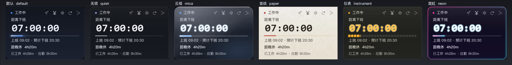

六套设置页都是**左栏导航 + 右侧内容卡片**（下面这张是默认皮肤的外观页，外观页最上面就是「界面风格」卡；其它五套见一图说明书第 06 节）：

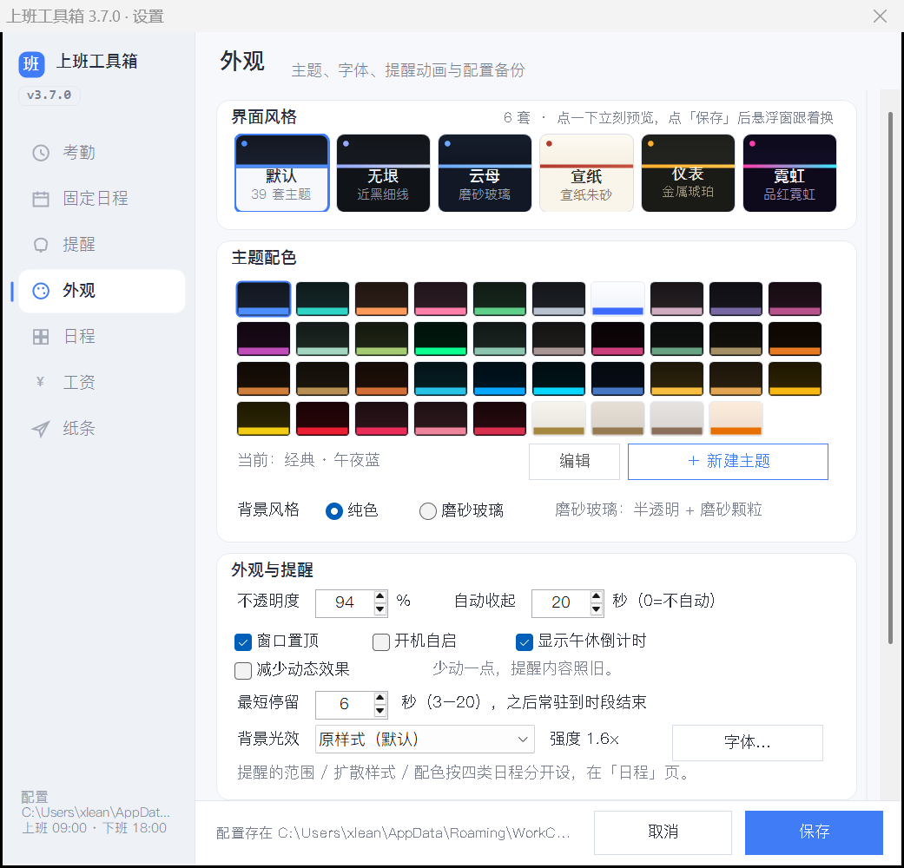

小纸条和右键胶囊也跟着换：云母走磨砂玻璃、宣纸是纸感、仪表细边、霓虹辉光。六套并排的截图在 `test/visual/skins/after/sheet-note-chat.png`、`sheet-bubble-theme.png`（截图产物，不入库），一图说明书第 06 节里也有。

## 视觉与动效（v1.3）

- 中文用**苹方**：Windows 上如果装的是「苹方 常规 / 苹方 粗体」，程序直接认这两个族（粗体用真「苹方 粗体」，不靠 GDI 伪加粗）；macOS 那种叫 `PingFang SC` 的也认。没装就退到 Noto Sans SC（苹方的开源近亲），再没有才用微软雅黑；也可以把 `PingFang.ttc` 放进 exe 旁边的 `fonts\` 目录，免安装直接用。倒计时默认用 Consolas 等宽数字，中文字体和数字字体都能在「外观 → 字体…」里分开改。主数字 28pt，展开提醒标题 17pt，辅助文字 **9–9.5pt**（比 8.5pt 那版大了一档）。
- 展开卡片侧边距 18 DIP，横条 14 DIP；数字和进度条分区，色块分界线不穿过字形。
- 整个窗口是**分层窗口**：每帧先画在一张 32 位带 alpha 的位图上，再用 `UpdateLayeredWindow` 整帧推给系统。圆角、字形、图标都走同一条抗锯齿路径，不再靠 `Region` 裁硬边；因此小字改用**灰阶抗锯齿**（ClearType 会在透明底上镶一圈彩边，看着像锯齿），整数像素定位，150% 下笔画干净。**这个窗口不能开双缓冲**：WinForms 在分层窗口上只要带了 `OptimizedDoubleBuffer`，就根本不调 `OnPaint`，第一帧永远出不来——窗口全透明，既看不见、也点不动（鼠标会穿透过去）。`Check` 里有一条断言专门守着它。
- 竖直节奏是**一个行距走到底**（6 DIP）：状态行、说明、大数字、进度、脚注依次往下排，每两行之间的空隙都一样；大号数字那一行按字形高度校准成 34 DIP，所以它上下的留白和普通文字行看起来等宽。卡片高度由内容算出来——含午休行 282px（150%），不含 246px，不再写死。
- 提醒卡的色块分界线固定落在「标题」和「时间」两行之间的空隙（64 DIP），所以压紧行距也不会切到字。
- 进度条走过的那一段带一圈外发光（右边收成羽毛状的尾巴，不会在前缘「啪」一下断掉），上面还有一道**流动的光带**按 2.6 秒一圈往前走；收起的小卡片也有。光带在两头都是**淡入淡出**的：走到尽头不会突然消失，而是在最后 30% 的行程里渐渐变淡，回到左边时也是从无到有（淡入 18%）。**距离下班不足 30 分钟时整条变成彩色**（绿→黄→橙→粉），一到点就恢复成主题色。午休那一行用粗体，隔着屏幕也能一眼找到。
- 剩下不到一小时时，大号数字从 `时:分:秒` 换成 `分:秒.厘秒`（每 50ms 跳一次），计时器也跟着提到 20Hz；一小时以上仍旧一秒一跳，不白费 CPU。
- 展开动画：窗口一边长高，**时间和进度条**这两样主视觉先浮上来，其余文字行（状态、说明、下一段、午休、最后一行）**错峰一行行**淡入并微微上移，每行隔 55ms，同一行里的元素共用一条时间线。

剩余不到一小时换成分:秒.厘秒，越到最后越有「在走」的感觉：


展开时一帧一帧是这样的：时间和进度条先到，其余行随后依次浮上来（0 / 70 / 150 / 240 / 340 / 460 / 620 ms）：


- 长标题固定可读字号，超出显示省略号。最近提醒的完整标题、时间、地点和备注可通过悬停查看。
- 提醒卡片上点哪儿都能收起（右上角的 × 只是把入口指出来），不用非得戳那个小叉
- 提醒卡上不带任何氛围特效（光晕、粒子、极光、扫光都去掉了），只剩「两张卡片叠上来」这个动作本身。
- 「减少动态效果」直接跳过叠卡动画和文字上浮，色块与文字一次到位；Windows 高对比度模式同理。
- 提醒期间暂停收起/展开，避免动画过程中改变文本布局。


验证：**Test 566 / Check 355 全绿**（色卡占比、文字对比度、提醒常驻时长、固定日程的重复规则与截止日、列表滚动、叠卡动画的先后顺序、行距与「最后 30 分钟」的彩色条、厘秒计时、圆角的半透明像素、展开时的错峰次序、「分层窗口别开双缓冲」、置顶被摘掉后看门狗能补回来、流光两头淡入淡出的曲线与绘制结果、新提醒从进度条末端扩散/停留两色/退场收回到卡片、背景光效 A/B 的取色、自建主题背景/进度条分开与存读、警戒带样式的存读与几何、抽屉卡的几何/三阶文字对比度/黄底与外角圆角/没拉够时不提前露内容、警戒带模式下卡片不做覆盖（并有非警戒带的对照）、胶囊菜单的主题色细边与「不再画投影」、关闭时先淡出再关窗口，以及三条点击路径：小卡片点开、右上角箭头收起、手抖 2 像素仍算点击；工资按钮只剩单击展开 / 收起、固定字段与双击处理都已移除；小纸条面板按 DIP 缩放、尺寸和卡片宽度无关、聊天正文字号 ≥ 9pt、新建对话（任意 5 位字符 = 对话码 / 5 位数字 = 个人 ID、非法码被拒）、对话码房间的消息落到对应对话且气泡带发送者 ID、发送后不整块刷新且不再提示「已发出」、圆角编辑窗（Region 与窗口同尺寸）、对话名字居中且比正文大一号、双击改名字（普通编辑窗、8 字截断、清空恢复 ID）、抽屉式未选对话收窄到 124、进对话不整屏淡入（无白雾）、整卡边框加粗到 1.8 DIP（像素 ≥3 行）、对话多了能滚（±1 / clamp / 首尾）、右键弹出「删除」并连联系人与线程一起删、双栏气泡文字垂直居中（像素断言）、v3.7.0 六套皮肤的令牌与换肤联动（默认皮肤逐像素未变）；v3.8.0 小纸条每个对话保留 16 条、历史页一屏 8 条可滚动；v3.8.1 群聊历史最后一行不再被输入框裁掉、未读左上角每 5 秒快闪两下（±1 / clamp / 两端不重复触发 / 重进回到最新一屏）、历史页动画 760ms（最后一行淡入完整）；v4.0.0 深模块重构（提醒决策 / 同步生命周期 / 配置保存结果可见 / 按实际变化应用配置）与检查更新页「更新记录」（8 个大版本、一屏 5 行可滚、最新一条用强调色））。

## 显示与缩放

程序使用系统 DPI 感知清单。150% 系统缩放下，展开卡片为 420×282 物理像素（不含午休行时 420×246），横条为 336×102；点单位字体与布局分别按 DPI 渲染，避免重复放大。测试覆盖 100% / 150% / 200% 的离屏渲染；混合 DPI 显示器间移动仍采用系统 DPI，可能由 Windows 缩放，并未宣称逐显示器适配。

## 数据来源：飞书对话

每 5 分钟（可调）用本机 `lark-cli` 读一次**当天**与考勤机器人（默认 `HRAT考勤大王`，可以改成你们公司的）的私聊，然后：

- **上班**：你今天发的 `1`（或「上班」「打卡」）；读不到时用机器人回复里的「上班时间：09:27」兜底。
- **下班**：你今天发的 `2`（或「下班」）；读不到时用「收工」消息里的 `09:33 → 20:08` 兜底。
- 状态：未上班 / 还没打卡 / 工作中 / 已达标（可下班）/ 已下班 / 休息日。

读的是你自己账号的聊天记录（`lark-cli` 的 user 身份），不改动对话，也不依赖机器人配合。

没配飞书（或者 `lark-cli` 没装）时程序不会瞎猜：直接按设置的班次推算，卡片上是 `上班 09:00 · 预计下班 18:00`，也不会出现「还没打卡」。这样别人拿去用，只填个上下班时间就能跑。

## 日程提醒

除了上下班，飞书日历里的会也能提醒你：


- **飞书日程**：每 15 分钟读一次今天 + 明天的日程，跳过你已拒绝的；同步**开始/结束时间、标题、位置（日程地点）、日程备注**，地点为空但带视频会议链接的显示「线上会议」。
- **手动日程**：设置 →「提醒」→ 右边填**标题（必填）+ 内容 + 日期 + 时间 + 时长 + 位置**，点「添加日程」。来不及拨日期也不要紧：下面一排**快速填入**——`3 分钟后`／`5 分钟后`／`15 分钟后`／`30 分钟后`／`1 小时后`，点一下就把日期和时间填好（时长还按当前选择算，默认 30 分钟）。内容会显示在提醒动画里，适合「三点半去取快递」这种不进日历的事。
- **加日程更快**：日期用日历面板选，时间是 15 分钟一档的下拉（也能直接打字 `16:20`），时长选完自动把「结束 17:50」算好并显示；左上还有三个快捷键——**30 分钟后**、**明天 9:30**、**下一整点**，点一下就把日期和时间填好。
- **两种提前量各自独立**：飞书日程算「会议」，用**会议提前**（默认 5 分钟）；手动加的是「日程」，用**日程提前**（默认 10 分钟）。都是 0～120 分钟可调，单条日程也能在 JSON 里用 `leadMinutes` 单独覆盖。
- **什么时候响**：开始时间 − 对应的提前量。提醒窗口一直延续到开始后 1 分钟，同一场会只响一次。设成 0 就是「正点响」。
- 列表里直接写着**真正会提醒的时刻**，比如 `11-04 11:31 提醒   11:34 需求对齐会 · 会议室 A`；保存设置后会弹一个托盘气泡，每次真正触发也会往 `widget.log` 写一行 `日程提醒: …`。
- **怎么响**：卡片先是一层主题底色的彩色面板（180ms 淡入），文字晚 70ms 再往上浮 7 DIP 浮进来——旧卡片的字在这段时间里一起淡掉，所以是交叉淡出，不会「字被扫掉一半」，中间也不会空一帧；退场反过来：先把字收掉，再把色块淡回普通卡片。
- **一响就常驻，直到这个时段过完**，不是闪几秒就走：
  | 提醒 | 常驻到 |
  |---|---|
  | 会议 / 日程 | 日程的**结束时间**（没有结束时间就 30 分钟） |
  | 午休 / 晚休 | **休息结束**那一刻（开始 → 结束 一直盖着） |
  | 午休结束 / 晚休结束 | 只停「最短停留」几秒——它本来就是一个瞬间 |
  | 下班 | 直到飞书同步到下班打卡 |

  常驻期间色块不动，上面那行 `还剩 12 分钟` 每秒跟着走；时段一到自动播退场动画（文字淡出 → 色块淡回），然后回到普通卡片。
- **想提前收掉**：提醒卡片右上角有个 `×`，点一下立刻退场；托盘菜单也有「关闭当前提醒：<标题>」。关掉的那一场今天不会再弹。
- 设置里的「最短停留 3–20 秒」是**下限**：时段本来就很短（或者已经过了一半）时，也至少停这么久再走。

  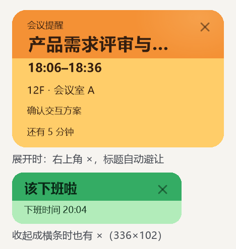

- **四类提醒四套配色**，一眼分清是哪一种；每套都先贴合当前主题的明暗：底色取主题底色，只把类别色染进去（约 45%），所以深色主题上不会再跳出一张浅色卡，浅色主题上也不会突然压一块深色：
  - 会议：主题底色 + 暖色（琥珀）染一层

    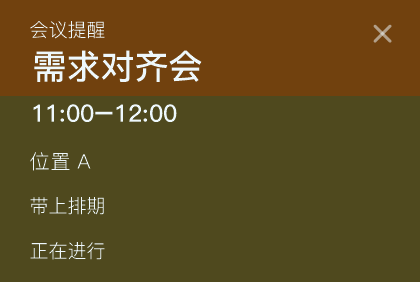

  - 日程：跟随当前主题（和下面同一套折算规则）

    

  - 午休：默认「蓝 · 玉茗」，青色双层（**可在设置里换**，见下）

    

  - 晚休：默认「紫 · 桔梗」，紫色双层（**可在设置里换**）

    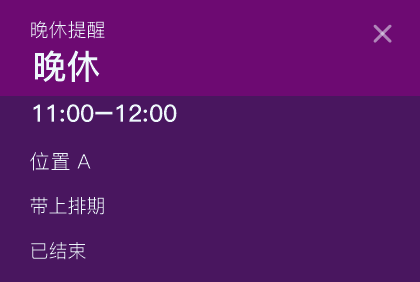

- **午休 / 晚休 / 下班以及自建日程的配色，逐条从已有的 39 套主题里挑**（设置 → 固定日程 → 配色），不新增任何色板：下拉第一项是「跟随当前主题」，后面就是主题列表本身（经典 7 套 + 中国传统色 32 套），每项左边画出这套主题折算出来的两层色带。

  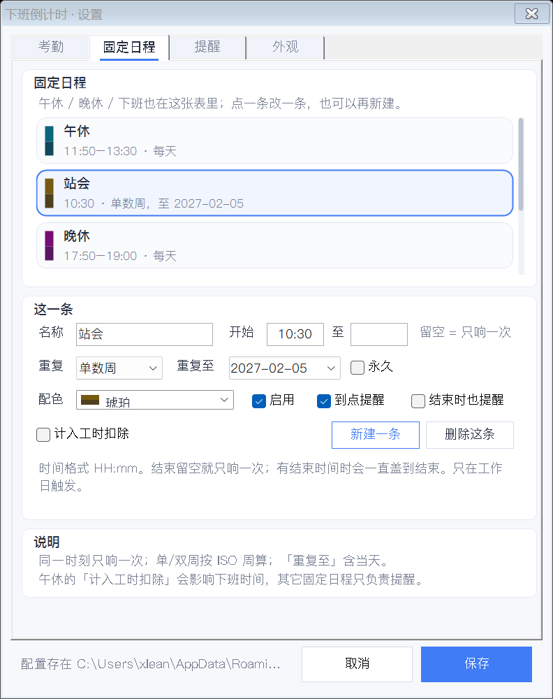

  折算规则：取那套主题的主色——亮主色（松林绿、琥珀、珍珠）走「浅一档 + 更浅一档 + 深字」，深主色（玉茗、桔梗、枫叶、午夜蓝）走「压深一档 + 再压深 + 浅字」。两层之间的色差最小 55（RGB 距离），40 项的文字对比度逐个验过，全部 ≥ 4.5:1。

  默认：午休 `蓝 · 玉茗`、晚休 `紫 · 桔梗`、下班 `经典 · 松林绿`——青、紫、绿三系，和「会议橙」「日程·主题色」也不会撞。

  

- 收起成横条时同样会被盖住，显示标题 + 时间 + 还有几分钟。
- 动画里的两行信息按卡片剩余高度均分，卡片矮的时候会自动省掉「内容」那一行，不会挤成一坨。
- 托盘菜单里有「下一个日程：…」「刷新飞书日程」，还有「预览提醒动画」——不用等到开会也能看效果。

读取走 `lark-cli calendar +agenda`，纯只读，不会动你的日历。

## 设置窗口

设置窗口是**左栏导航 + 右侧内容卡片**（v3.7.0 起；原来是顶部一排七个标签），窗口约 690×640 DIP，标题栏带版本号。左栏七项不变，只是换了摆法：

| 导航项 | 内容 |
|---|---|
| **考勤** | 班次与工时（固定/弹性、上下班、每日应勤）、工作日、节假日与调休 |
| **固定** | 午休 / 晚休 / 下班 + 自己加的固定动作：时间、重复（每天 / 单数周 / 双数周）、重复至、配色、到点提醒、计入工时扣除 |
| **提醒** | 飞书考勤对话、日程与提醒（会议提前 / 日程提前、日程列表、加日程的表单） |
| **外观** | **界面风格（v3.7.0：默认 / 无垠 / 云母 / 宣纸 / 仪表 / 霓虹）**、主题配色（含自建主题、双色编辑；非默认皮肤下置灰）、外观与提醒、背景光效、配置备份（导出 / 导入 / 恢复默认） |
| **日程** | 多份 Outlook / Exchange 日历订阅（.ics 或 Graph 登录）+ 四类日程各自的通知样式 |
| **工资** | 月工资、发薪日；自动算本月应出勤、日薪，并预览今日累计口径 |
| **纸条** | 小纸条：面板样式 A/C、本机 5 位 ID、公共中继、对话（个人 ID / 对话码）、滚动与右键删除 |

外观页从上到下是四张卡：**界面风格 → 主题配色 → 外观与提醒 → 配置备份**（页面比可视高度长，滚轮 / 右侧滚动条都能滚到下面的卡）。卡片式分组、细边、圆角，主操作「保存」是强调色实心按钮；左栏当前项高亮。窗口本身也会跟着当前皮肤换色换圆角。整个窗口按系统 DPI 整体放大（150% 屏不会出现「字大了框没大」的挤压）。

| 固定日程 | 提醒 |
|---|---|
|  |  |

日程列表里的小卡片**点一下展开**看全部信息（真正会响的时刻、时段、位置、备注），再点收起；固定日程列表点哪条就改哪条。**固定日程超过三条时列表会自动出现滚动条**（滚轮、拖滑块都行），新建的加在最后并自动滚到眼前，不会把上面几条顶掉。

## 考勤策略

设置窗口（`⚙`）里可配：

- **固定班次**：上班 `09:00`、下班 `18:00`，都可改。倒计时按班次下班时间走。
- **弹性工时**：按「实际上班打卡时间 + 每日应勤」推算下班。**默认就是你现在的情况**：10 小时 30 分，所以 09:27 打卡 → 19:57 下班（和考勤大王给的预计时间一致）。
- **扣除午休**：可选，默认关闭。开启后午休区间从工时里扣掉；关闭时按纯钟表差计算（考勤大王现在就是纯钟表差，所以默认关）。
- **工作日**：周一~周日逐个勾选（勾的是「周一到周日」要上班的那几天；v3.5 修好了界面与内部索引差一天、导致「周五上班却显示休息」的问题，另有「周一~周五 / 周一~周六 / 每天」快捷按钮）。**旧版本存坏了的配置会在启动时自动修一次**（把错位的数组移回正确的那天，只做一次），修完相当于帮你点了一次「周一~周五」——如果你本来就是别的排班，进设置确认一遍即可。
- **节假日与调休**：按日期加例外——某天「休息」或「某天上班（调休）」。也可以在托盘菜单里「今天设为休息日 / 上班日」临时改今天。

## 配置与日志

| 内容 | 位置 |
|---|---|
| 设置 | `%APPDATA%\WorkCountdown\settings.json` |
| 运行日志（只在飞书读取失败时写） | `%APPDATA%\WorkCountdown\widget.log` |
| 开机自启 | 托盘菜单或设置里的勾选项，写入 `HKCU\...\CurrentVersion\Run` |

## 一键打卡需要补一个权限

托盘菜单里的「在飞书发「1」/「2」打卡」会以你本人身份发消息。当前 `lark-cli` 的授权里没有 `im:message.send_as_user`，所以在补授权前点它会弹窗提示。

在终端跑一次即可（会打开授权页，点同意就行）：

```powershell
lark-cli auth login --scope "im:message.send_as_user"
```

补完之后就能在悬浮窗里直接打卡，不用切到飞书。不补也不影响读取和倒计时。

## 出问题时

- **卡片显示「还没打卡」但你在飞书里发过**：先点 `↻` 手动同步；仍不行就查 `lark-cli auth status` 是否 `user` 身份可用。
- **提示「飞书读取失败」**：卡片底部会显示原因（未授权 / 会话 ID 不对 / 命令找不到）。设置里点「测试连接」会给出更具体的信息，「自动发现」可以按机器人名重新找会话 ID。
- **找不到窗口**：可能在另一块屏幕的边上；从托盘图标双击可以把它切回来。

## 打包给同事

```powershell
.\package.ps1            # 编译 + 打包（dist\上班工具箱-v<Version>.zip），并自动发 GitHub Release
.\package.ps1 -NoPublish # 只打包，不发布
```

> **v3.6 起打包会自动发布**：`package.ps1` 出完 zip 会调 `tools/release.ps1` → `git add -A` + commit（`release: 上班工具箱 v<Version>`）→ push `origin main` + tag → 建/更新 GitHub Release `v<Version>` → 上传两个资产：`WorkCountdown-v<Version>.zip`（完整包）和 `WorkCountdown.exe`（程序里「检查更新」做全量更新用）。
> GitHub 的 Release 资产名**会抹掉中文**（实测 `上班工具箱-v3.6.0.zip` 上传后变成 `-v3.6.0.zip`），所以线上资产名用 ASCII `WorkCountdown-v<Version>.zip`，本地 zip 名仍是中文；重复发布会先删掉同名 / 多余的旧资产，幂等。

压缩包里就 7 个文件加一个 `fonts\` 空目录（约 2 MB，主要是一图说明书 PNG），发给别人后：

| 文件 | 作用 |
|---|---|
| `安装.cmd` | 双击即装：复制到 `%LOCALAPPDATA%\Programs\WorkCountdown`、建桌面快捷方式、启动 |
| `卸载.cmd` | 删程序、删快捷方式、关掉开机自启；配置目录保留并提示路径 |
| `install.ps1` / `uninstall.ps1` | 上面两个 cmd 的实际逻辑（cmd 只是纯 ASCII 外壳，避免代码页问题） |
| `使用说明.txt` | 给最终用户看的说明 |
| `一图说明书.png` | 所有界面 / 功能 / 设置项的 2400×11386 长图（v3.7.0 重出，第 06 节是六套界面风格） |
| `WorkCountdown.exe` | 程序本体 |

**在线更新**：已发布到 GitHub Release（`ocezeus/vibeZheyikuai`，最新 `v4.0.0`），老版本用户在卡片上右键 →「检查更新」就能全量更新到最新版。

**首次启动会弹一个引导窗口**，只问三件事：上下班时间（固定班次 / 弹性工时）、午休、要不要读飞书打卡。填完写一份 `settings.json`，以后不再弹；点「先跳过」也会落一份默认配置。

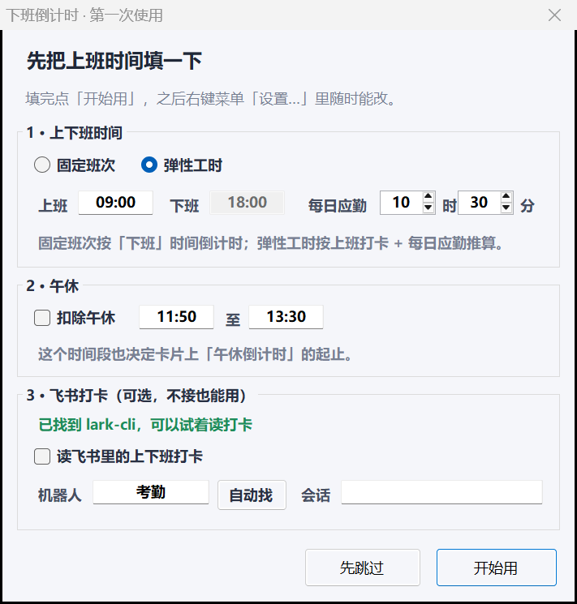

对方没有飞书、没有 `lark-cli` 也能用：卡片直接按班次推算（`上班 09:00 · 预计下班 18:00`），不会出现「还没打卡」这种它根本不知道的信息；引导窗口里那一步会显示「这台机器上没有 lark-cli」并自动置灰。


便携模式：把 exe 单独拷到任意文件夹，同目录建一个空文件 `portable.txt`（或者带 `--portable` 启动一次），配置就会写到同目录的 `data\` 里，U 盘可用、不需要写 `%APPDATA%`。

配置可迁移：托盘菜单有「导出配置… / 导入配置…」，把你调好的主题、策略、日程整个发给同事，他导入即可。

## 开发与构建

```powershell
# 编译（生成 assets\app.ico 和 dist\WorkCountdown.exe）
.\build.ps1

# 编译 + 建桌面快捷方式
.\build.ps1 -Shortcut

# 编译 + 直接启动
.\build.ps1 -Run

# 编译 + 打包成可分发的 zip
.\package.ps1

# 只打包、不自动发 GitHub Release
.\package.ps1 -NoPublish

# 已有 zip 时单独发版：提交 / push / 建 Release / 上传 zip + 自动更新 exe
.\tools\release.ps1 -Version 4.0.0
.\tools\release.ps1 -Version 4.0.0 -DryRun     # 预演，不 commit / 不 push / 不调写接口

# 一图说明书出图：改 design\manual-poster.html 后跑，生成根目录 manual-poster.png（2400 px 宽）
.\design\render-poster.ps1
```

`package.ps1` 默认打包完就会调用 `tools/release.ps1`：`git add -A` → 有改动才 commit（`release: 上班工具箱 v<Version>`）→ `git push origin main` + tag → 建/更新 GitHub Release（`v<Version>`，draft/prerelease=false，说明优先取 `-Notes`、否则 CHANGELOG 对应小节）→ 先删同名旧资产再上传 **zip + `WorkCountdown.exe`**（后者给「检查更新」的全量更新用）。token 从 `$env:GITHUB_TOKEN` 或 `git credential fill` 取，不写死；重复跑只更新、不堆资产。

| 文件 | 作用 |
|---|---|
| `src/Models.cs` | 设置模型、持久化、考勤策略与状态计算（纯逻辑，无 UI）；v3.7.0 加 `UiSettings.skin`（默认 `default`，非法值归默认） |
| `src/Skins.cs` | v3.7.0 六套界面风格：SkinDef（配色 / 圆角 / 描边 / 高光 / 进度条画法 / 数字发光 / 字体 / 朱砂印章 / 螺丝 / 玻璃标识）+ `Skins.Current` / `ResolveTheme` / `UsesGlass` / `CardBorderColor` / `GlowColor` |
| `src/Lark.cs` | 调 `lark-cli` 读会话 / 发消息 / 读日历日程，解析打卡 |
| `src/Widget.cs` | 悬浮窗：绘制、卡片内提醒动画、收起展开、拖拽吸附、胶囊菜单入口、小纸条入口与边框闪光、托盘；v3.6 起还管「预览通知」和「检查更新」的线程与状态 |
| `src/Frost.cs` | 磨砂玻璃背景（v3.6）：半透明主题底 + 柔光雾气 + 模糊噪点 tile + 斜向反光 + 玻璃边缘高光，卡片/小纸条/胶囊三处共用 |
| `src/Updates.cs` | 自动更新（v3.6）：GitHub Release 检查（API + HTML 兜底、强制 TLS 1.2）、下载与进度、FileVersion 校验、临时 `.cmd` 全量替换 exe 并重启 |
| `src/ScreenReminderForm.cs` | 全屏提醒：桌面截图底图、柔边扩散、标题/色块擦出、自动收回；警戒带（整屏黄条 + 呼吸反色 + 反向滚动的文字与斜纹） |
| `src/DrawerForm.cs` | 警戒带之后的抽屉卡：分层窗按像素 alpha 推帧、实心黄底 + 同色系三阶文字、宽度动画（内容被硬裁）、点击收回 |
| `src/SettingsForm.cs` | 设置窗口（v3.7.0 起左栏导航 + 内容卡片，690×640 DIP；按系统 DPI 整体缩放控件树；自绘主题色卡、日程列表、日程卡片、调色窗和「界面风格」选择器；第 7 页「纸条」） |
| `src/FirstRunForm.cs` | 首次启动引导（班次 / 午休 / 飞书三选） |
| `src/NotePanelForm.cs` | 小纸条面板（分层窗）：A 抽屉式 / C 极简双栏两种布局、对话胶囊（滚轮滚动 / 右键删除）、聊天/历史/新建对话、对话码房间（气泡带发送者 ID）、发送与行内编辑器、双击改名字、1.8 DIP 整卡边框 |
| `src/NoteRelay.cs` | 小纸条公共中继：手写 MQTT 3.1.1（TCP），个人 ID 收件箱 + 对话码房间主题（`xzt/v1/room/<hex>`）、在线探测、断线重连 |
| `src/Program.cs` | 入口、单实例、`--portable` / `--settings` |
| `package.ps1` | 打包脚本：生成 install/uninstall 脚本、说明和 zip；v3.6 起打包完自动调 `tools/release.ps1` 发版（`-NoPublish` 可只打包） |
| `tools/release.ps1` | GitHub 发版（v3.6）：校验资产 → commit / push / tag → 建或更新 Release → 上传 zip + 自动更新 exe；`-DryRun` / `-SkipPush` / `-Notes` |
| `assets/app.manifest` | DPI 感知清单（构建时生成并嵌入 exe） |
| `test/Test.cs` | 策略、状态、日程提醒、小纸条、磨砂玻璃、六套皮肤令牌、6 胶囊几何、更新版本比较的断言测试（334 条，全绿；另有 600 个离屏渲染组合） |
| `test/Check.cs` | 界面与规则的独立验收（316 条：色卡占比、提醒常驻、重复规则、自建日程触发、自建主题进列表、小卡片点开、右上角箭头收起、手抖 2 像素仍算点击、分层窗口没开双缓冲、置顶被摘掉后看门狗补回来、流光两头淡入淡出、提醒扩散设置、卡片扩散与退场、背景光效开关、自建主题背景/进度条分开、调色方块点击、列表滚动、叠卡动画、行距与「最后 30 分钟」、抽屉卡几何/配色/裁切、警戒带不上卡片、胶囊主题色细边/无投影/淡出后退场、工资按钮无双击固定、小纸条面板按 DIP 缩放与正文字号、空对话码提示、新建对话（对话码 vs 个人 ID）、对话码房间气泡带发送者 ID、发送后不整屏刷新/不提示已发出/圆角编辑窗/对话名字居中与字号/双击改名字用普通编辑窗/抽屉未选对话收窄/进对话不淡入、整卡边框加粗与双栏气泡文字居中的像素断言、对话滚动 ±1/clamp、右键删除命中区与删除回调；v3.6 新增：磨砂玻璃三处渲染的像素 alpha 断言、预览通知 6 chip 几何与路由、检查更新七态按钮、Widget 预览通知生命周期、昵称胶囊几何/双击/截断；v3.7.0 新增六套皮肤的令牌 / 设置页左栏换肤联动 / 主题色卡置灰提示 / 小纸条与胶囊换肤） |
| `test/build-tests.ps1` | 一条命令编译并跑上面两套测试，**已经带好 DPI 感知清单参数**（不带会假失败 3 条） |
| `test/DocShots.cs` | 离屏渲染 README 用的设置窗口截图（`doc-*.png`） |
| `test/Variants.cs` | 生成行距对比图 `variants.png` 和字体对比图 `fonts.png`（挑版式用） |
| `test/Measure.cs` | 像素扫描量每行字的真实空隙，用来校准大号数字那一行的高度 |
| `test/Flow.cs` | 提醒出场 / 退场的逐帧拼图 `flow.png`：看两张卡片怎么叠上来 |
| `test/Spacing.cs` | 行距 3/4/5/6 DIP 并排渲染成 `spacing.png`（挑行距用） |
| `test/Soon.cs` | 最后 60 分钟的三种计时（45 分 / 12 分 / 90 秒）+ 展开错峰的分帧（`soon.png`、`expand.png`） |
| `test/GifFrames.cs` | 生成 README 顶部那张动图的逐帧图（入场 / 停留 / 退场，每 50ms 一张） |
| `test/BarPreview.cs` | 进度条三态：正常 / 剩 22 分钟彩色 / 剩 5 分钟，`bar.png` |
| `test/FlowFade.cs` | 流光淡出探针：把进度条右半段放大，按相位排一列看「走到尽头」是不是渐渐变淡（`visual/flow-fade.png`） |
| `test/BubbleExitShot.cs` | 胶囊菜单退场逐帧：同一张「修改主题」面板按 0→180ms 出 13 帧（`visual/bubble-exit/f*.png`） |
| `test/NoteShot.cs` | 小纸条面板 A/C 六种状态（对话列表 / 滚动 + 右键删除 / 聊天 / 历史 / 新建对话 / 对话码房间）+ 卡片贴边闪光出图，DPI 感知按 150% 出真实尺寸（`visual/note-new/`） |
| `test/SkinCardShot.cs` | v3.7.0 六套皮肤卡片出图：六套展开态并排（`visual/skins/sheet-expanded.png`）、收起态、工资、提醒，并和 v3.6 基线逐像素比对默认皮肤（本版 16 张图：11 张 0 像素差、5 张 1 像素差） |
| `test/SkinSettingsShot.cs` | v3.7.0 六套设置页实拍（`visual/skins/settings-*.png`）+ 切皮肤联动自检：色卡置灰提示、保存写字段、外观页滚轮滚动 |
| `test/SkinNoteShot.cs` | v3.7.0 小纸条面板 / 右键胶囊六套皮肤出图 + 默认皮肤基线比对（`visual/skins/after/`） |
| `test/V36Shot.cs` | v3.6 新视觉出图：磨砂玻璃卡片（深/浅 × 纯色/玻璃，压在假桌面上看透视）、抽屉页两排联系人 + 昵称胶囊、6 胶囊 / 预览面板 / 检查更新四态、设置页外观、六类预览通知帧，并真打一次 GitHub API 验证更新检查（`V36Shot.exe test\visual\v36`） |
| `test/NoteEditorShot.cs` | 小纸条圆角编辑窗 / 整卡细边框实拍（`PrintWindow`，锁屏也能拍，`visual/note-fix/`） |
| `test/NoteClick.cs` | 小纸条交互回归探针：真实鼠标点「＋ 新建对话 / 字段 / 查在线 / 创建对话 / 连发 / 发送按钮 / 双击改名字」，验证非模态编辑窗、实时同步、发完输入框留着、命中区随高度移动（`NoteClick.exe`，ALL PASS 才算过；锁屏 / 无输入桌面时自动退化成 `PostMessage` 点按并打印说明） |
| `test/RelayProbe.cs`、`test/NoteSend.cs` | 公共中继实测：两个 ID 互发 / 给正在跑的机器发一条 |
| `test/Crisp.cs` | 小字清晰度对比：字号 / 抗锯齿 / 灰度的四种组合并排渲染 |
| `test/LiveCard.cs` | 用真实配置渲染当前主题下的展开卡 + 收起条（`live-card.png`） |
| `tools/shot.ps1` | 用 `PrintWindow` 抓悬浮窗画面（分层窗口用 BitBlt 截不到） |
| `test/SettingsShot.cs` | 多放几条固定日程后截「固定日程」页，验证列表滚动、新建自动滚过去 |
| `test/FontProbe.cs` | 打印当前解析到的中文字体（确认苹方有没有生效） |
| `test/Pos.cs` | 打印每块屏幕的范围，并用真实配置跑一次 `PlaceInitial`：「窗口跑到屏幕外、打开看不见」就是它查的 |
| `test/Screens.cs` | 只打印所有屏幕的 bounds / workingArea，排查多屏坐标用 |
| `tools/refresh-images.py` | 把离屏渲染的图片换成 README 里的正式图 |

> `build.ps1` / `package.ps1` 必须保存成 **UTF-8 带 BOM**，否则 PowerShell 5 会按 GBK 解析中文注释并报「字符串缺少终止符」。

跑测试：

```powershell
.\test\build-tests.ps1          # 编译 + 跑两套，全绿才返回 0
.\test\build-tests.ps1 -NoRun   # 只编译
```

脚本里固定带着 `/win32manifest:assets\app.manifest`——手动 `csc` 时漏了它，`Check` 在 150% 缩放下会假失败 3 条（那几条看着像动画 bug，其实是 DPI 感知没开）。

技术栈是 .NET Framework 4.x + WinForms（`csc.exe` 直接编译，不依赖 SDK 或运行时安装），产物是单个约 360 KB 的 exe，Win10 / Win11 自带运行时，不需要装任何东西。

## 已知边界

- 贴边吸附按「窗口所在的那块屏幕」计算，但首次启动默认主屏；多屏时把它拖到想放的屏幕即可，位置会记住。
- DPI 感知是「系统级」的：同一次登录里所有显示器 DPI 相同（你这里是 144）就完全准确；如果一台 100%、一台 200% 混用，拖到另一块屏上会被系统轻微拉伸。
- 圆角边缘由窗口区域裁剪，靠近看能见到 1 像素的台阶；不会再出现之前那圈白边。
- 目前只识别你发的 `1/2/上班/下班` 和机器人回复里的固定句式；机器人换文案时不会崩，会退化成只读你说的「1/2」。
- 应用是未签名的本地 exe，首次运行 SmartScreen 可能提示一次。
- 日程提醒只在程序运行时触发：关机或没开程序时不会补提醒；重启后如果还落在提醒窗口内（开始前提前量到开始后 1 分钟），会再放一次动画。
- 手动日程按本机时区理解；飞书日程自带时区，会先换算成本机时间再比。
- 飞书日程目前取的是**你本人的主日历**（`+agenda --as user`），别人的加班/共享日历不会读。
- 小纸条用公共 MQTT 中继，消息在公共网络上明文转发，别发密码等敏感内容；中继不存离线消息，对方不在线时这条发不出去。`
- 小纸条的 5 位 ID 随机生成，重装 / 重新生成会变；不同电脑碰巧同 ID 的概率很低，但没做中心化唯一性校验。
- 小纸条每对 ID / 每个对话码最多留最近 16 条，更早的会被新消息挤掉；历史页一屏显示 8 条，其余用滚轮往上翻；陌生人发来的纸条会自动加一个只显示 ID 的对话。
- 对话码是**公开可进的**（公共 MQTT 中继，谁输入同一个 5 位码谁就进来），别用公司名 / 工号 / 生日之类容易猜的码。
- **磨砂玻璃是「拟态」不是真实背景模糊**（v3.6）：半透明 + 磨砂颗粒 + 柔光，桌面会透出来但不是逐像素模糊；要真模糊得抓屏再模糊，秒/厘秒动画会掉帧。
- **自动更新（v3.6）**：只在 Release 里有独立 `WorkCountdown.exe` 资产时能自动全量替换；下载到 `%TEMP%\WorkCountdown-update\`，替换时旧 exe 备份成 `.bak`，失败会自动回滚并留窗口提示。GitHub API 未登录 60 次/小时/IP，被限流时只能「打开发布页」手动下载。一图说明书已按 v3.7.0 重出（2400×11386）。
- **GitHub Release 资产名只能 ASCII**（v3.6 实测）：中文资产名会被抹掉（`上班工具箱-v3.6.0.zip` → `-v3.6.0.zip`），所以线上 zip 叫 `WorkCountdown-v3.6.0.zip`；本地 zip / 压缩包里的文件名仍是中文。
