# 下班倒计时 · Windows 悬浮窗

一个贴在屏幕边缘的桌面小窗口：平时只显示「还剩几小时几分」，点开是完整卡片（倒计时、进度、上班/预计下班时间）。
默认数据来自你飞书里和考勤机器人的私聊：你在那边发「1」上班、「2」下班，这边自动读到并算下班时间；不接飞书也能用，按班次时间推算。

| 收起（贴边） | 展开 |
|---|---|
|  | 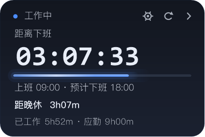 |

## 现在就能用

- 桌面已经放好快捷方式 **下班倒计时**，双击即可启动；启动后贴在主屏右侧边缘。
- **第一次启动**会弹一个引导窗口，问上下班时间、午休、要不要读飞书打卡；填完点「开始用」。
- 启动后**不会**重复开第二个：再双击只会静默退出（单实例）。
- 退出：右键悬浮窗 → 退出，或托盘图标右键。

## 界面怎么用

收起态是一条**横向**的小横条，一眼能读完：

```
● 距离下班                    下班 20:04
05:30:56
▔▔▔▔▔▔▔▔▔▔▔▔▔▔▔▔▔
```

左边状态点 + 一行说明，中间大号等宽倒计时，右上角是预计下班时间（午休时段换成「休 1h05m」），底部一条细进度。

| 操作 | 效果 |
|---|---|
| 单击收起态的横条 | 展开成卡片 |
| 卡片右上角 `⚙` | 打开设置 |
| 卡片右上角 `↻` | 立刻重新读一次飞书 |
| 卡片右上角 `›` | 收回成横条 |
| 按住拖动 | 移动；松手靠近左右边缘会自动吸附贴边，位置会记住 |
| 展开后 20 秒没动静 | 自动收回（设置里可改，0 = 不自动） |
| 右键 | 设置、立即同步、刷新日程、下一个日程、预览提醒动画、在飞书发「1」/「2」打卡、展开/收起、今天设为休息日/上班日、窗口置顶、开机自启、退出 |

## 固定日程（午休 / 晚休 / 下班 / 自己加）

卡片里除了主倒计时，还有一行「接下来是什么」，按当前时刻自动切换，一天走完这一列：

| 时刻 | 显示 |
|---|---|
| 11:50 之前 | `● 距午休 1h30m`（每分钟跟着走） |
| 11:50–13:30 | `● 午休中 还剩 1h05m`（数值变成强调色） |
| 13:30–18:00 | `● 距晚休 4h30m` |
| 18:00–18:45 | `● 晚休中 还剩 35m` |
| 18:45 之后 | `● 马上下班` |

时间来自设置 →「固定日程」里的那几条，**和「计入工时扣除」开关无关**：扣除只决定工时怎么算，倒计时只按时间点走。收起成横条时，右上角显示 `休 1h30m` / `晚 45m`。

没开晚休时，午休结束这一行改成 `距下班 2h10m`，到点同样变成 `马上下班`——不会凭空出现一个你没设过的晚休时间。

设置里「显示午休倒计时」可以关掉，卡片会退回原高度、不留空白；午休时间填错（比如 `25:00`）时这行自动不显示。

### 固定日程表

设置 →「固定日程」是一张表，**午休、晚休、下班本身就是表里的三条**，点一条改一条；想加「站会」「拉伸」「吃药」这类固定动作，点「新建一条」。每条能设：

| 项 | 说明 |
|---|---|
| 名称 | 提醒里显示的名字 |
| 开始 – 结束 | `HH:mm`；结束留空 = 只响一次（打卡类的用这个）；有结束时间就一直盖到结束 |
| 重复 | **每天** / **单数周** / **双数周**（按 ISO 周，周一是第一天） |
| 重复至 | 到某年某月某日为止（含当天），勾「永久」就不设截止 |
| 配色 | 从现有主题色里挑一套，直接用在提醒色带上；`跟随当前主题` 会跟着外观页的主题走 |
| 启用 / 到点提醒 | 停用后既不显示也不响；到点提醒关掉只留卡片上的倒计时 |
| 结束时也提醒 | 结束那一刻再响一次（午休结束、晚休结束就是它） |
| 计入工时扣除 | 只有午休用：勾上后这段时间从应勤时长里扣掉，下班时间往后顺延 |

「下班」这条不用填开始时间——时间来自班次（弹性工时 = 打卡 + 应勤），它只负责「该下班啦」这个提醒什么时候弹；重复规则决定哪天弹。

三条内置的只能改、不能删（防止误删把卡片搞空），自己加的可以删。所有固定日程**只在工作日触发**，节假日/调休按「考勤」页设置走。

### 午休 / 晚休到点提醒

| 设置项 | 默认 | 作用 |
|---|---|---|
| 午休 `11:50` 至 `13:30` | 已填 | 卡片上的午休倒计时 + 到点提醒 |
| 晚休 `18:00` 至 `18:45` | 已启用 | 卡片上的晚休倒计时 + 到点提醒 |
| 到点提醒 / 结束时也提醒 | 已勾选 | 到点自动弹同款提醒动画 |

四个时间点各响一次（每天一次，只在工作日响）：`午休时间到`、`午休结束`、`晚休时间到`、`晚休结束`。动画里显示时段区间和「还剩 40 分钟」，配色跟着这条日程选的色走，一眼能区分「这是休息，不是会议」。

**休息期间一直盖着**：`午休时间到` 响起之后不会自己退，会一直盖到 13:30（你设的休息结束），上面那行「还剩 40 分钟」每秒跟着走；到点播退场动画、恢复正常卡片。`午休结束` 那条因为本身是瞬间，只按最短停留放几秒。晚休同理，从 17:50 盖到 19:00。嫌挡着就点右上角 `×`。

**中途才打开也不会漏**：如果 18:10 才启动（或重启）程序，正处在晚休里，会直接补一张「晚休中 17:50–19:00 · 还剩 50 分钟」的常驻卡，不用等到下一次 17:50。

取消「到点提醒」就只保留卡片上的倒计时，不弹动画。
### 到点不走？常驻「该下班啦」

到下班时间还没在飞书里打卡，卡片会一直被这条提醒盖住：


逐帧的样子（`alert-preview.gif` 是动图）：


- 第一行 `注意`，第二行 `该下班啦`，下面两行是下班时间和「在飞书发「2」打卡后自动消失」。
- **配色是清爽绿**，不是警示红：默认取「经典 · 松林绿」，上半 `#56BB7C`、下半浅薄荷 `#A2E4BB`，两块色距 106，一眼看得出是两条；字用深绿，对比度 7.8:1 / 12.7:1。这套也能换（设置 → 外观 → 提醒配色 → 下班，39 套主题任选）。
- **常驻**：不会自己走掉，也不会自动收起成横条。
- 右上角 `×`（或右键 →「关闭当前提醒」）＝ 忽略今天，今天不再弹，第二天自动恢复。
- **每 5 分钟重播一次**：文字淡出再淡入，卡片本身不动——不闪屏但看得见。
- 飞书一同步到下班打卡（或你手动改系统时间过跨天），立即收掉，恢复正常卡片。
- 万一飞书读不到、或者你今天就打算不走这一趟：右键 →「忽略今天的下班提醒」，今天不再弹，第二天自动恢复。
- 中间如果插进来一个会议/日程提醒，它播完会回到这条常驻提醒。
- 静止期间不跑 30fps 的动画计时器，只在重播那 1.1 秒里刷新，平时几乎不占 CPU。

## 外观与主题

**39 套内置配色 + 自己调的无限多套**，设置 →「外观」里点一下色块就生效（悬停显示名字，选中的外圈发蓝光）：

每格是**卡片缩略图**：底色占绝大部分，高亮色只做底部一条「进度条」和左上角一个状态点——比例和真实卡片一致，扫一眼就知道换上之后是什么样子（实测高亮色占 10%–11%，不会再出现「整块砖头色」那种占比失衡）。

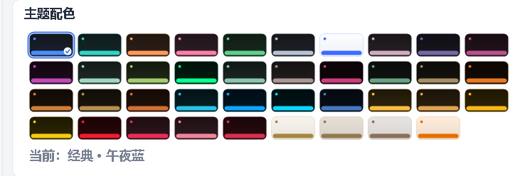

- **经典 7 套**：午夜蓝（默认）、极光青、落日橙、樱花粉、松林绿、石墨灰、象牙白——手工调过对比度。
- **中国传统色 32 套**：紫 / 绿 / 灰 / 棕 / 蓝 / 黄 / 红 / 白 八个色系，每系四色（凤信、藤萝、豆蔻、桔梗……），颜色直接从你给的色卡上取样。
- 色卡每格只给一个主色，其余颜色按主色推导：卡片底取主色的极暗版，强调色（状态点、进度条、图标）保持原色相——太暗的提亮、太亮的压深，尽量不兑成灰。
- 四个「白」系（鱼肚、珍珠、银苗、荷花）是浅色卡片，文字自动转深色，白天挨着飞书窗口不刺眼。

每套主题定义的是完整配色：卡片渐变底色、主/次/弱三级文字色、进度条轨道色、强调色，以及「已达标 / 已下班」用的成功色。

### 自己调一套主题

色卡右边「＋ 新建主题」打开调色窗：左边色相条选颜色家族，方块里选深浅，右边实时预览这套配色做出来的卡片和提醒色带。起个名字（比如「苔绿」）点保存，它就变成色卡里的一格，**存在 `settings.json` 里**，换主题、重启都在；不想要了下次删掉配置里的那一条即可。

推导规则和内置主题完全一样：你只给一个主色，其余自动算，所以自定义主题的观感不会和内置的脱节。

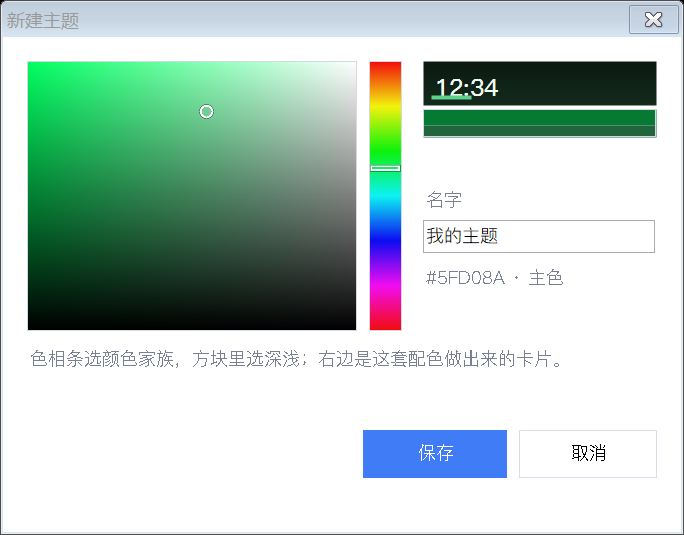

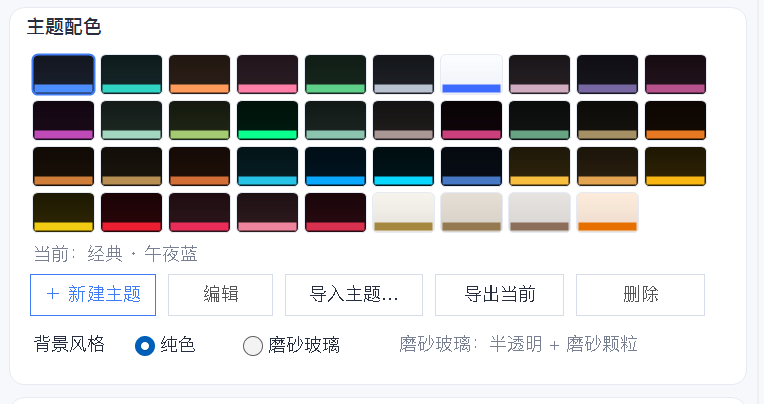

## 视觉与动效（v1.3）

- 中文用**苹方**：Windows 上如果装的是「苹方 常规 / 苹方 粗体」，程序直接认这两个族（粗体用真「苹方 粗体」，不靠 GDI 伪加粗）；macOS 那种叫 `PingFang SC` 的也认。没装就退到 Noto Sans SC（苹方的开源近亲），再没有才用微软雅黑；也可以把 `PingFang.ttc` 放进 exe 旁边的 `fonts\` 目录，免安装直接用。倒计时用 Consolas 等宽数字。主数字 28pt，展开提醒标题 17pt，辅助文字 **9–9.5pt**（比 8.5pt 那版大了一档）。
- 展开卡片侧边距 18 DIP，横条 14 DIP；数字和进度条分区，色块分界线不穿过字形。
- 整个窗口是**分层窗口**：每帧先画在一张 32 位带 alpha 的位图上，再用 `UpdateLayeredWindow` 整帧推给系统。圆角、字形、图标都走同一条抗锯齿路径，不再靠 `Region` 裁硬边；因此小字改用**灰阶抗锯齿**（ClearType 会在透明底上镶一圈彩边，看着像锯齿），整数像素定位，150% 下笔画干净。**这个窗口不能开双缓冲**：WinForms 在分层窗口上只要带了 `OptimizedDoubleBuffer`，就根本不调 `OnPaint`，第一帧永远出不来——窗口全透明，既看不见、也点不动（鼠标会穿透过去）。`Check` 里有一条断言专门守着它。
- 竖直节奏是**一个行距走到底**（6 DIP）：状态行、说明、大数字、进度、脚注依次往下排，每两行之间的空隙都一样；大号数字那一行按字形高度校准成 34 DIP，所以它上下的留白和普通文字行看起来等宽。卡片高度由内容算出来——含午休行 282px（150%），不含 246px，不再写死。
- 提醒卡的色块分界线固定落在「标题」和「时间」两行之间的空隙（64 DIP），所以压紧行距也不会切到字。
- 进度条走过的那一段带一圈外发光（右边收成羽毛状的尾巴，不会在前缘「啪」一下断掉），上面还有一道**流动的光带**按 2.6 秒一圈往前走；收起的小卡片也有。**距离下班不足 30 分钟时整条变成彩色**（绿→黄→橙→粉），一到点就恢复成主题色。午休那一行用粗体，隔着屏幕也能一眼找到。
- 剩下不到一小时时，大号数字从 `时:分:秒` 换成 `分:秒.厘秒`（每 50ms 跳一次），计时器也跟着提到 20Hz；一小时以上仍旧一秒一跳，不白费 CPU。
- 展开动画：窗口一边长高，**时间和进度条**这两样主视觉先浮上来，其余文字行（状态、说明、下一段、午休、最后一行）**错峰一行行**淡入并微微上移，每行隔 55ms，同一行里的元素共用一条时间线。

剩余不到一小时换成分:秒.厘秒，越到最后越有「在走」的感觉：

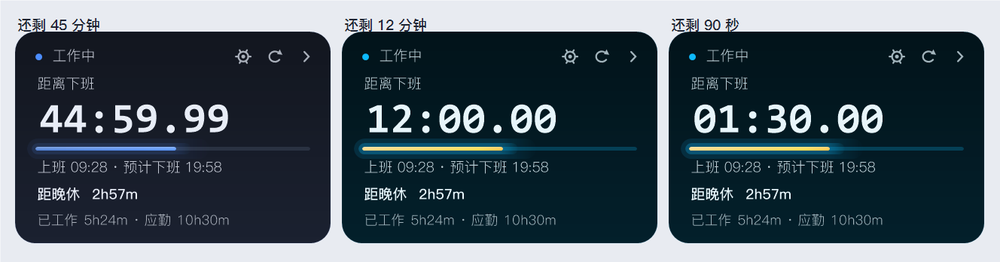

展开时一帧一帧是这样的：时间和进度条先到，其余行随后依次浮上来（0 / 70 / 150 / 240 / 340 / 460 / 620 ms）：

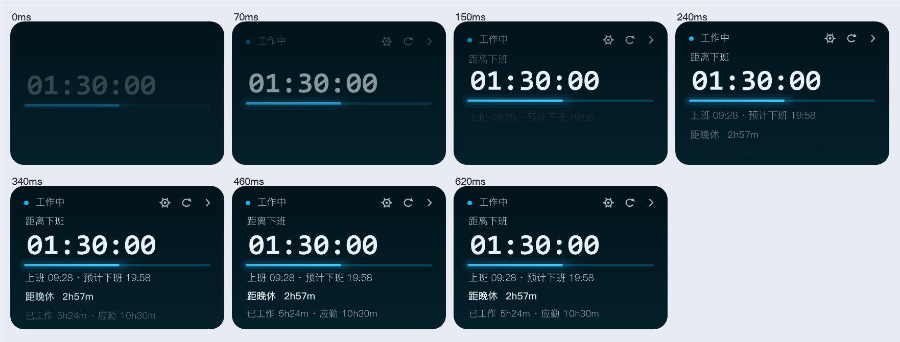

- 长标题固定可读字号，超出显示省略号。最近提醒的完整标题、时间、地点和备注可通过悬停查看。
- 提醒卡片上点哪儿都能收起（右上角的 × 只是把入口指出来），不用非得戳那个小叉
- 提醒卡上不带任何氛围特效（光晕、粒子、极光、扫光都去掉了），只剩「两张卡片叠上来」这个动作本身。
- 「减少动态效果」直接跳过叠卡动画和文字上浮，色块与文字一次到位；Windows 高对比度模式同理。
- 提醒期间暂停收起/展开，避免动画过程中改变文本布局。

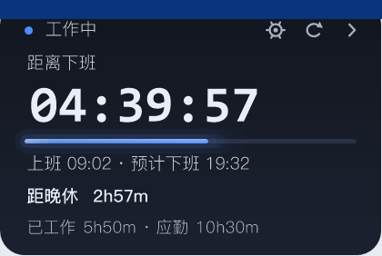


验证：97 条逻辑断言 + 125 条界面与规则验收断言（色卡占比、文字对比度、提醒常驻时长、固定日程的重复规则与截止日、列表滚动、叠卡动画的先后顺序、行距与「最后 30 分钟」的彩色条、厘秒计时、圆角的半透明像素、展开时的错峰次序、「分层窗口别开双缓冲」，以及三条点击路径：小卡片点开、右上角箭头收起、手抖 2 像素仍算点击）。

## 显示与缩放

程序使用系统 DPI 感知清单。150% 系统缩放下，展开卡片为 420×282 物理像素（不含午休行时 420×246），横条为 336×102；点单位字体与布局分别按 DPI 渲染，避免重复放大。测试覆盖 100% / 150% / 200% 的离屏渲染；混合 DPI 显示器间移动仍采用系统 DPI，可能由 Windows 缩放，并未宣称逐显示器适配。

## 数据来源：飞书对话

每 5 分钟（可调）用本机 `lark-cli` 读一次**当天**与考勤机器人（默认 `HRAT考勤大王`，可以改成你们公司的）的私聊，然后：

- **上班**：你今天发的 `1`（或「上班」「打卡」）；读不到时用机器人回复里的「上班时间：09:27」兜底。
- **下班**：你今天发的 `2`（或「下班」）；读不到时用「收工」消息里的 `09:33 → 20:08` 兜底。
- 状态：未上班 / 还没打卡 / 工作中 / 已达标（可下班）/ 已下班 / 休息日。

读的是你自己账号的聊天记录（`lark-cli` 的 user 身份），不改动对话，也不依赖机器人配合。

没配飞书（或者 `lark-cli` 没装）时程序不会瞎猜：直接按设置的班次推算，卡片上是 `上班 09:00 · 预计下班 18:00`，也不会出现「还没打卡」。这样别人拿去用，只填个上下班时间就能跑。

## 日程提醒

除了上下班，飞书日历里的会也能提醒你：

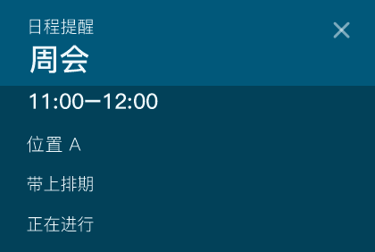

- **飞书日程**：每 15 分钟读一次今天 + 明天的日程，跳过你已拒绝的；同步**开始/结束时间、标题、位置（日程地点）、日程备注**，地点为空但带视频会议链接的显示「线上会议」。
- **手动日程**：设置 →「提醒」→ 右边填**标题（必填）+ 内容 + 日期 + 时间 + 时长 + 位置**，点「添加日程」。来不及拨日期也不要紧：下面一排**快速填入**——`3 分钟后`／`5 分钟后`／`15 分钟后`／`30 分钟后`／`1 小时后`，点一下就把日期和时间填好（时长还按当前选择算，默认 30 分钟）。内容会显示在提醒动画里，适合「三点半去取快递」这种不进日历的事。
- **加日程更快**：日期用日历面板选，时间是 15 分钟一档的下拉（也能直接打字 `16:20`），时长选完自动把「结束 17:50」算好并显示；左上还有三个快捷键——**30 分钟后**、**明天 9:30**、**下一整点**，点一下就把日期和时间填好。
- **两种提前量各自独立**：飞书日程算「会议」，用**会议提前**（默认 5 分钟）；手动加的是「日程」，用**日程提前**（默认 10 分钟）。都是 0～120 分钟可调，单条日程也能在 JSON 里用 `leadMinutes` 单独覆盖。
- **什么时候响**：开始时间 − 对应的提前量。提醒窗口一直延续到开始后 1 分钟，同一场会只响一次。设成 0 就是「正点响」。
- 列表里直接写着**真正会提醒的时刻**，比如 `11-04 11:31 提醒   11:34 需求对齐会 · 会议室 A`；保存设置后会弹一个托盘气泡，每次真正触发也会往 `widget.log` 写一行 `日程提醒: …`。
- **怎么响**：卡片先是一层主题底色的彩色面板（180ms 淡入），文字晚 70ms 再往上浮 7 DIP 浮进来——旧卡片的字在这段时间里一起淡掉，所以是交叉淡出，不会「字被扫掉一半」，中间也不会空一帧；退场反过来：先把字收掉，再把色块淡回普通卡片。
- **一响就常驻，直到这个时段过完**，不是闪几秒就走：
  | 提醒 | 常驻到 |
  |---|---|
  | 会议 / 日程 | 日程的**结束时间**（没有结束时间就 30 分钟） |
  | 午休 / 晚休 | **休息结束**那一刻（开始 → 结束 一直盖着） |
  | 午休结束 / 晚休结束 | 只停「最短停留」几秒——它本来就是一个瞬间 |
  | 下班 | 直到飞书同步到下班打卡 |

  常驻期间色块不动，上面那行 `还剩 12 分钟` 每秒跟着走；时段一到自动播退场动画（文字淡出 → 色块淡回），然后回到普通卡片。
- **想提前收掉**：提醒卡片右上角有个 `×`，点一下立刻退场；右键菜单也有「关闭当前提醒：<标题>」。关掉的那一场今天不会再弹。
- 设置里的「最短停留 3–20 秒」是**下限**：时段本来就很短（或者已经过了一半）时，也至少停这么久再走。

  

- **四类提醒四套配色**，一眼分清是哪一种；每套都先贴合当前主题的明暗：底色取主题底色，只把类别色染进去（约 45%），所以深色主题上不会再跳出一张浅色卡，浅色主题上也不会突然压一块深色：
  - 会议：主题底色 + 暖色（琥珀）染一层

    

  - 日程：跟随当前主题（和下面同一套折算规则）

    

  - 午休：默认「蓝 · 玉茗」，青色双层（**可在设置里换**，见下）

    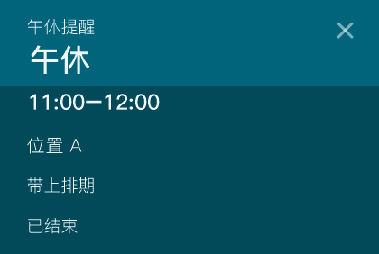

  - 晚休：默认「紫 · 桔梗」，紫色双层（**可在设置里换**）

    

- **午休 / 晚休 / 下班以及自建日程的配色，逐条从已有的 39 套主题里挑**（设置 → 固定日程 → 配色），不新增任何色板：下拉第一项是「跟随当前主题」，后面就是主题列表本身（经典 7 套 + 中国传统色 32 套），每项左边画出这套主题折算出来的两层色带。

  

  折算规则：取那套主题的主色——亮主色（松林绿、琥珀、珍珠）走「浅一档 + 更浅一档 + 深字」，深主色（玉茗、桔梗、枫叶、午夜蓝）走「压深一档 + 再压深 + 浅字」。两层之间的色差最小 55（RGB 距离），40 项的文字对比度逐个验过，全部 ≥ 4.5:1。

  默认：午休 `蓝 · 玉茗`、晚休 `紫 · 桔梗`、下班 `经典 · 松林绿`——青、紫、绿三系，和「会议橙」「日程·主题色」也不会撞。

  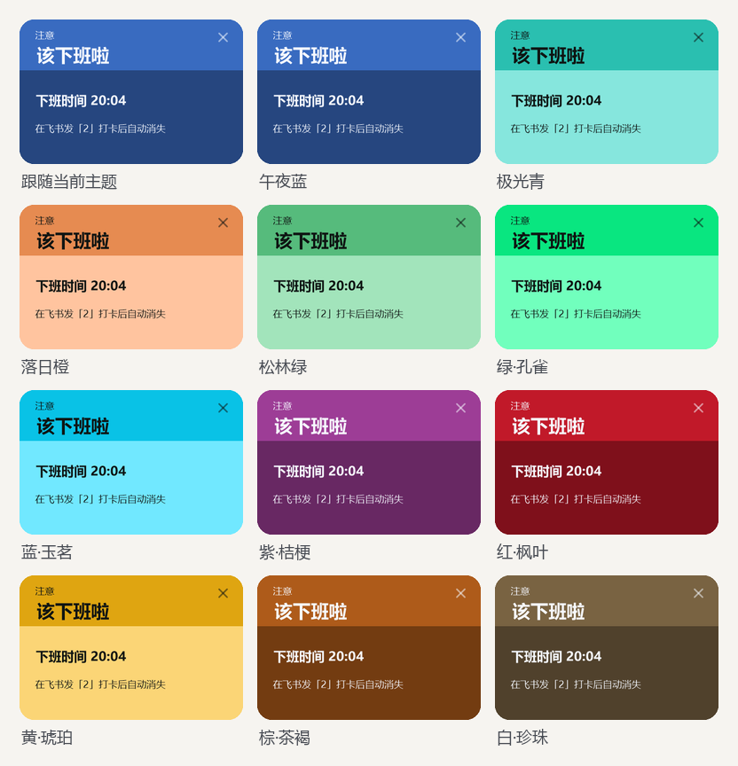

- 收起成横条时同样会被盖住，显示标题 + 时间 + 还有几分钟。
- 动画里的两行信息按卡片剩余高度均分，卡片矮的时候会自动省掉「内容」那一行，不会挤成一坨。
- 右键菜单里有「下一个日程：…」「刷新飞书日程」，还有「预览提醒动画」——不用等到开会也能看效果。

读取走 `lark-cli calendar +agenda`，纯只读，不会动你的日历。

## 设置窗口

设置窗口分四个标签页，一页一类，不再是一个长条：

| 标签页 | 内容 |
|---|---|
| **考勤** | 班次与工时（固定/弹性、上下班、每日应勤）、工作日、节假日与调休 |
| **固定日程** | 午休 / 晚休 / 下班 + 自己加的固定动作：时间、重复（每天 / 单数周 / 双数周）、重复至、配色、到点提醒、计入工时扣除 |
| **提醒** | 飞书考勤对话、日程与提醒（会议提前 / 日程提前、日程列表、加日程的表单） |
| **外观** | 主题配色（含自建主题）、外观与启动、配置备份（导出 / 导入 / 恢复默认） |

卡片式分组、细边、圆角，主操作「保存」是强调色实心按钮；标签页自己画，选中时白底 + 底部强调色短线。窗口按系统 DPI 整体放大（150% 屏不会出现「字大了框没大」的挤压）。

| 固定日程 | 提醒 |
|---|---|
| 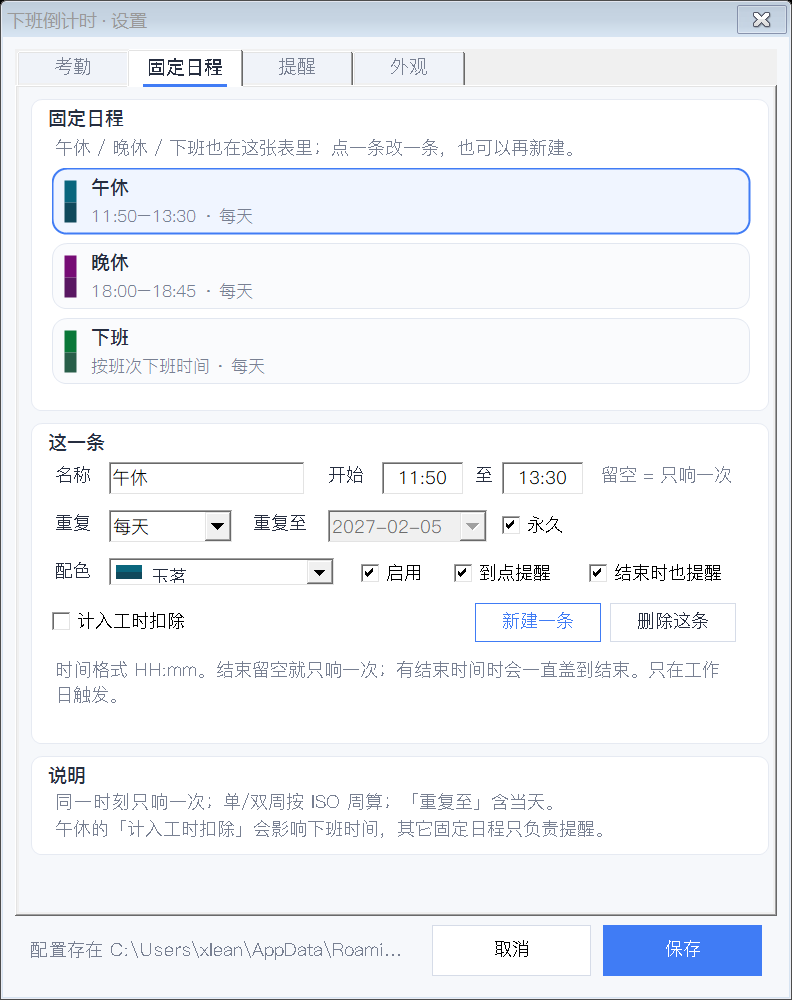 | 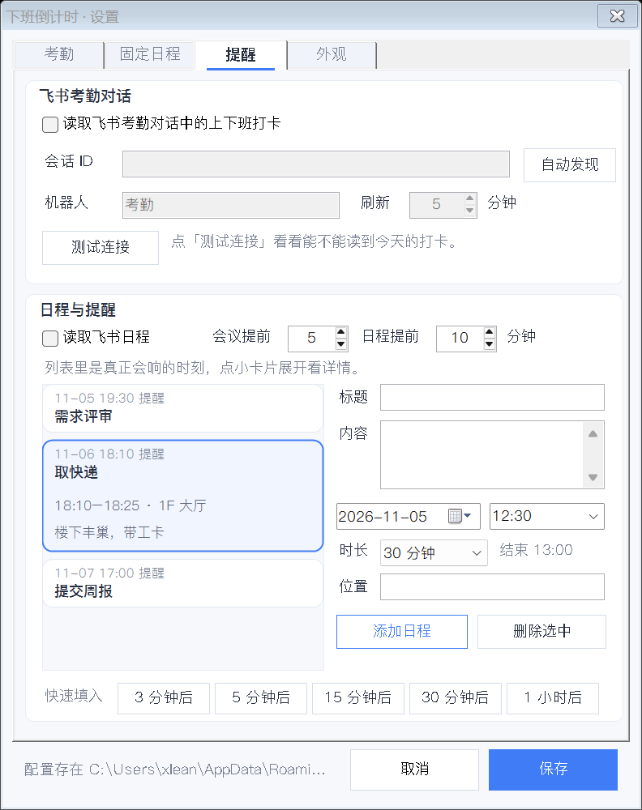 |

日程列表里的小卡片**点一下展开**看全部信息（真正会响的时刻、时段、位置、备注），再点收起；固定日程列表点哪条就改哪条。**固定日程超过三条时列表会自动出现滚动条**（滚轮、拖滑块都行），新建的加在最后并自动滚到眼前，不会把上面几条顶掉。

## 考勤策略

设置窗口（`⚙`）里可配：

- **固定班次**：上班 `09:00`、下班 `18:00`，都可改。倒计时按班次下班时间走。
- **弹性工时**：按「实际上班打卡时间 + 每日应勤」推算下班。**默认就是你现在的情况**：10 小时 30 分，所以 09:27 打卡 → 19:57 下班（和考勤大王给的预计时间一致）。
- **扣除午休**：可选，默认关闭。开启后午休区间从工时里扣掉；关闭时按纯钟表差计算（考勤大王现在就是纯钟表差，所以默认关）。
- **工作日**：周一~周日逐个勾选。
- **节假日与调休**：按日期加例外——某天「休息」或「某天上班（调休）」。也可以直接右键「今天设为休息日 / 上班日」临时改今天。

## 配置与日志

| 内容 | 位置 |
|---|---|
| 设置 | `%APPDATA%\WorkCountdown\settings.json` |
| 运行日志（只在飞书读取失败时写） | `%APPDATA%\WorkCountdown\widget.log` |
| 开机自启 | 右键菜单或设置里的勾选项，写入 `HKCU\...\CurrentVersion\Run` |

## 一键打卡需要补一个权限

右键菜单里的「在飞书发「1」/「2」打卡」会以你本人身份发消息。当前 `lark-cli` 的授权里没有 `im:message.send_as_user`，所以在补授权前点它会弹窗提示。

在终端跑一次即可（会打开授权页，点同意就行）：

```powershell
lark-cli auth login --scope "im:message.send_as_user"
```

补完之后就能在悬浮窗里直接打卡，不用切到飞书。不补也不影响读取和倒计时。

## 出问题时

- **卡片显示「还没打卡」但你在飞书里发过**：先点 `↻` 手动同步；仍不行就查 `lark-cli auth status` 是否 `user` 身份可用。
- **提示「飞书读取失败」**：卡片底部会显示原因（未授权 / 会话 ID 不对 / 命令找不到）。设置里点「测试连接」会给出更具体的信息，「自动发现」可以按机器人名重新找会话 ID。
- **找不到窗口**：可能在另一块屏幕的边上；从托盘图标双击可以把它切回来。

## 打包给同事

```powershell
.\package.ps1            # 编译 + 打包，产物在 dist\下班倒计时-v1.3.zip
```

压缩包里就 6 个文件加一个 `fonts\` 空目录（约 82 KB），发给别人后：

| 文件 | 作用 |
|---|---|
| `安装.cmd` | 双击即装：复制到 `%LOCALAPPDATA%\Programs\WorkCountdown`、建桌面快捷方式、启动 |
| `卸载.cmd` | 删程序、删快捷方式、关掉开机自启；配置目录保留并提示路径 |
| `install.ps1` / `uninstall.ps1` | 上面两个 cmd 的实际逻辑（cmd 只是纯 ASCII 外壳，避免代码页问题） |
| `使用说明.txt` | 给最终用户看的说明 |
| `WorkCountdown.exe` | 程序本体 |

**首次启动会弹一个引导窗口**，只问三件事：上下班时间（固定班次 / 弹性工时）、午休、要不要读飞书打卡。填完写一份 `settings.json`，以后不再弹；点「先跳过」也会落一份默认配置。


对方没有飞书、没有 `lark-cli` 也能用：卡片直接按班次推算（`上班 09:00 · 预计下班 18:00`），不会出现「还没打卡」这种它根本不知道的信息；引导窗口里那一步会显示「这台机器上没有 lark-cli」并自动置灰。

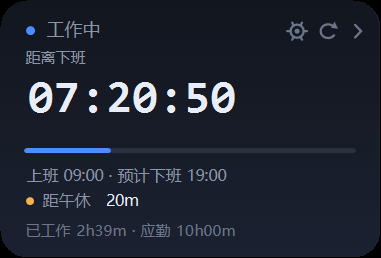

便携模式：把 exe 单独拷到任意文件夹，同目录建一个空文件 `portable.txt`（或者带 `--portable` 启动一次），配置就会写到同目录的 `data\` 里，U 盘可用、不需要写 `%APPDATA%`。

配置可迁移：右键菜单有「导出配置… / 导入配置…」，把你调好的主题、策略、日程整个发给同事，他导入即可。

## 开发与构建

```powershell
# 编译（生成 assets\app.ico 和 dist\WorkCountdown.exe）
.\build.ps1

# 编译 + 建桌面快捷方式
.\build.ps1 -Shortcut

# 编译 + 直接启动
.\build.ps1 -Run

# 编译 + 打包成可分发的 zip
.\package.ps1
```

| 文件 | 作用 |
|---|---|
| `src/Models.cs` | 设置模型、持久化、考勤策略与状态计算（纯逻辑，无 UI） |
| `src/Lark.cs` | 调 `lark-cli` 读会话 / 发消息 / 读日历日程，解析打卡 |
| `src/Widget.cs` | 悬浮窗：绘制、两色块提醒动画、收起展开、拖拽吸附、右键菜单、托盘 |
| `src/SettingsForm.cs` | 设置窗口（四标签页 + 卡片式分组，按系统 DPI 整体缩放控件树；自绘主题色卡、日程列表、日程卡片和调色窗） |
| `src/FirstRunForm.cs` | 首次启动引导（班次 / 午休 / 飞书三选） |
| `src/Program.cs` | 入口、单实例、`--portable` / `--settings` |
| `package.ps1` | 打包脚本：生成 install/uninstall 脚本、说明和 zip |
| `assets/app.manifest` | DPI 感知清单（构建时生成并嵌入 exe） |
| `test/Test.cs` | 策略、状态与日程提醒的断言测试（97 条，全绿；另有 600 个离屏渲染组合） |
| `test/Check.cs` | 界面与规则的独立验收（125 条：色卡占比、提醒常驻、重复规则、自建日程触发、自建主题进列表、小卡片点开、右上角箭头收起、手抖 2 像素仍算点击、分层窗口没开双缓冲、列表滚动、叠卡动画、行距与「最后 30 分钟」） |
| `test/build-tests.ps1` | 一条命令编译并跑上面两套测试，**已经带好 DPI 感知清单参数**（不带会假失败 3 条） |
| `test/DocShots.cs` | 离屏渲染 README 用的设置窗口截图（`doc-*.png`） |
| `test/Variants.cs` | 生成行距对比图 `variants.png` 和字体对比图 `fonts.png`（挑版式用） |
| `test/Measure.cs` | 像素扫描量每行字的真实空隙，用来校准大号数字那一行的高度 |
| `test/Flow.cs` | 提醒出场 / 退场的逐帧拼图 `flow.png`：看两张卡片怎么叠上来 |
| `test/Spacing.cs` | 行距 3/4/5/6 DIP 并排渲染成 `spacing.png`（挑行距用） |
| `test/Soon.cs` | 最后 60 分钟的三种计时（45 分 / 12 分 / 90 秒）+ 展开错峰的分帧（`soon.png`、`expand.png`） |
| `test/GifFrames.cs` | 生成 README 顶部那张动图的逐帧图（入场 / 停留 / 退场，每 50ms 一张） |
| `test/BarPreview.cs` | 进度条三态：正常 / 剩 22 分钟彩色 / 剩 5 分钟，`bar.png` |
| `test/Crisp.cs` | 小字清晰度对比：字号 / 抗锯齿 / 灰度的四种组合并排渲染 |
| `test/LiveCard.cs` | 用真实配置渲染当前主题下的展开卡 + 收起条（`live-card.png`） |
| `tools/shot.ps1` | 用 `PrintWindow` 抓悬浮窗画面（分层窗口用 BitBlt 截不到） |
| `test/SettingsShot.cs` | 多放几条固定日程后截「固定日程」页，验证列表滚动、新建自动滚过去 |
| `test/FontProbe.cs` | 打印当前解析到的中文字体（确认苹方有没有生效） |
| `test/Pos.cs` | 打印每块屏幕的范围，并用真实配置跑一次 `PlaceInitial`：「窗口跑到屏幕外、打开看不见」就是它查的 |
| `test/Screens.cs` | 只打印所有屏幕的 bounds / workingArea，排查多屏坐标用 |
| `tools/refresh-images.py` | 把离屏渲染的图片换成 README 里的正式图 |

> `build.ps1` / `package.ps1` 必须保存成 **UTF-8 带 BOM**，否则 PowerShell 5 会按 GBK 解析中文注释并报「字符串缺少终止符」。

跑测试：

```powershell
.\test\build-tests.ps1          # 编译 + 跑两套，全绿才返回 0
.\test\build-tests.ps1 -NoRun   # 只编译
```

脚本里固定带着 `/win32manifest:assets\app.manifest`——手动 `csc` 时漏了它，`Check` 在 150% 缩放下会假失败 3 条（那几条看着像动画 bug，其实是 DPI 感知没开）。

技术栈是 .NET Framework 4.x + WinForms（`csc.exe` 直接编译，不依赖 SDK 或运行时安装），产物是单个 107 KB 的 exe，Win10 / Win11 自带运行时，不需要装任何东西。

## 已知边界

- 贴边吸附按「窗口所在的那块屏幕」计算，但首次启动默认主屏；多屏时把它拖到想放的屏幕即可，位置会记住。
- DPI 感知是「系统级」的：同一次登录里所有显示器 DPI 相同（你这里是 144）就完全准确；如果一台 100%、一台 200% 混用，拖到另一块屏上会被系统轻微拉伸。
- 圆角边缘由窗口区域裁剪，靠近看能见到 1 像素的台阶；不会再出现之前那圈白边。
- 目前只识别你发的 `1/2/上班/下班` 和机器人回复里的固定句式；机器人换文案时不会崩，会退化成只读你说的「1/2」。
- 应用是未签名的本地 exe，首次运行 SmartScreen 可能提示一次。
- 日程提醒只在程序运行时触发：关机或没开程序时不会补提醒；重启后如果还落在提醒窗口内（开始前提前量到开始后 1 分钟），会再放一次动画。
- 手动日程按本机时区理解；飞书日程自带时区，会先换算成本机时间再比。
- 飞书日程目前取的是**你本人的主日历**（`+agenda --as user`），别人的加班/共享日历不会读。
